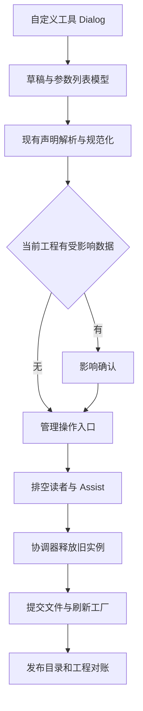

# 实现架构与管理生命周期

## 最小新增职责

| 组件 | 负责 | 复用/限制 |
|---|---|---|
| ToolEditorController（QObject） | 当前草稿、脏状态、应用/删除请求、影响摘要 | 调用现有 AppController 管理链，不持有第二个 RuntimeEngine |
| ToolPortListModel（QAbstractListModel） | 业务行与固定前缀投影、选中标识、增删移动 | 数据存 ToolDefinition 的 vector；fixed 为派生角色，portId 是真实编号；displayIndex 不作身份 |
| CustomToolStore（普通 C++ 类） | 用户根路径、JSON 原子写、新工具目录发布、删除/恢复 | 复用 DefinitionJson、ToolPaths；不参与业务执行 |
| CustomToolDialog/PortProperties QML | 列表、属性、交互和主题绑定 | 不解析 schema、不直接写磁盘、不维护另一套类型校验 |
| 已有 ToolPackage/Registry/PythonRuntime/ProjectStorage | 合并发现、工厂解析、刷新、项目对账 | 保留载荷类型与所有权语义；参数键升级为 PortId，无额外插件服务框架 |

类型目录由 C++ 根据 TypeSpec/已有 supportedTypes 能力生成给 QML；不要在三个新文件里手写三份 token 表。普通 helper 优先函数/组合，不让每种类型派生一个 UI 类；继承仅用于 QObject 模型和现有工具接口；模板仅用于已存在的类型映射。参数列表模型不是工具参数解析基类的替代品，工具继续使用 Contracts/SDK。

## 持久目录与扫描

用户根固定在软件目录下 `custom-tools`（与可执行文件同级），不写用户配置目录、`%LOCALAPPDATA%` 或系统盘。布局为 `tools/` 声明、`python/` 代码和其资源；与 ToolRoots 两个根一一对应。交互偏好 `ui-preferences.json` 与 `logs/` 同属软件目录，Qt 的着色器/管线磁盘缓存关闭，避免隐式写入用户缓存目录。安装包升级/force-clean 只替换程序文件，保留 `custom-tools`、`logs`、`ui-preferences.json`。

当前 readToolsPackage(root, customRoots) 是**替换**随包 custom 的语义。实现新增合并时应抽取其内部已有“扫描一对 ToolRoots”的小函数：先按现有流程验证安装包及 module_index，再扫描用户根，把结果合并至候选目录，统一检测工具 ID 重复。保持已有替换接口语义或同步改所有调用/测试，不能不加说明就把参数当追加根。

同 ID 不做优先级覆盖，不引入目录优先级策略链。复制工具生成新工具 ID 与独立目录；若外部新增文件冲突，保留旧已发布目录，报告两个来源路径。用户根首期直接新建 Python；C++ 仍必须有发行模块索引与工厂，走已验证包导入，不扫描任意 DLL。

来源权限由“是否用户根内的自有文件”决定；ToolOrigin::Custom 本身不足以表示可修改，因为随包 custom 示例也属于 Custom。可在编辑器推导 editableSource；不把访问权限塞进数据载荷或工具 JSON。

## 保存的事务边界

元数据修改只写一个声明文件，使用 QSaveFile(QString) 并禁用直接写回退；write 完整成功后 commit。写前保存原始字节与文件摘要，在应用时发现外部改动则要求重新载入/明确覆盖；一个轻量内容比较即可，不建立数据库版本系统。应用单个当前工具；失败时保留草稿。

创建新工具：先在扫描根外准备代码/资源/声明；校验路径、声明和所需文件，再把代码目录发布到最终位置，最后以原子写发布 JSON。JSON 是发现入口，写出它之前扫描器不能看到半成品。失败清理本次新建目录，绝不能删已有用户目录。无声明的孤立代码目录不能被自动当工具加载。

已有代码首期由外部编辑器保存，“刷新工具”通过既有 Python 重新加载链生效；参数移动/改名不重新生成或重写代码。新建 Python 模板仅创建一次，不能每次构建跑生成器。不要宣称 QSaveFile 能原子更新 JSON 与多个代码文件；本轮不实现跨文件事务平台。后续若支持内嵌编辑，代码保存与声明提交分开命名并保留备份。

删除时先撤销/移走声明使其不可被发现，协调器释放实例后处理自有代码目录；若目录仍被其他自定义声明引用则保留。不强制释放其他消费者持有的图像/Array owner。逻辑删除与实际磁盘清理失败分别记录，不能删到一半却继续显示“删除成功”。无需实现全盘垃圾收集。

## 应用重载顺序

1. 草稿经现有 parser/normalizer/validator；检查路径和工厂存在性属于合法性，不执行算法试跑。
2. 在工程副本上使用现有 reconcile 规则算差异，需确认时只确认具体破坏性变更。草稿打开版本与当前文件不一致时重新预览。
3. 通过既有管理入口禁止并发 Apply/Run/Reset/Close 重叠；有运行时等其结束，不在 GUI 同步 stop-and-wait。
4. beginDrain 排空显示、文本和 Assist；协调器释放将替换实例。现有 Owner/模块保活继续生效，不另立只读或复制策略。
5. 提交单文件声明，扫描候选合并目录，调用既有 requestRefresh/refreshFinished 更新工厂。只有成功完成才替换可见目录、应用工程对账并清脏状态。
6. 普通写入/装配失败：恢复旧声明字节，重新加载旧目录；显示失败，草稿仍在。若旧目录恢复也失败，保持运行禁用并提供具体错误/重试，不能把半失败说成“旧实例仍正常”。

该协议保证普通失败的可恢复性，不声称断电时多目录全事务。元数据单文件替换是原子的；新建 JSON-last 保证不发现未完成条目。管理状态尽量复用 ProjectOperations/已有 refresh 命令，避免另建平行状态机。

## 工程兼容与资源寿命

纯排序/显示名变更应无损。类型变更/删端口按 ProjectStorage 既有规则处理 current project，提示准确内容后生效，项目 dirty 不静默保存。项目中的缺失工具节点保留，便于用户恢复声明。旧结果与正在读取的 Image/ROI/Array 清理仍遵守现有读回 ACK 与跨语言 owner 生命周期；若外部持有 view，它延长资源寿命，不强制卸载底层模块。

自定义工具保存不会重置底部“已运行”时钟；未实际运行则不写运行指标。双击单工具运行不累计底部流程时间等原有规则保持；工具代码返回错误文字不额外拼节点前缀。日志只记录一次保存/删除/重载结果和必要错误，不对每个拖动像素、每个列表行刷日志。

## Contracts 与工具参数接口

目标 C++ 以 `using PortId = std::uint32_t; using Values = std::map<PortId, PortValue>;` 替换字符串 map。复用现有容器、参数基类和注册机制，不为按编号取值新建通用参数框架。保留稀疏编号，因此内存随实际端口数增长；不能用最大编号扩一个巨大 vector。元数据 vector 用于显示顺序，Values map 用于执行取值，这两个职责不同。

C++ 推荐 InputReader::integer(id)/image(id)/array(id) 等返回已有 ReadResult，OutputWriter 接受 PortId；合法读写路径不拷贝像素。const Values 使用 find/at，避免 `operator[]` 插入空值；不为追求一模一样的 `[]` 语法再套一层容器。Python dict 使用 int 键，按 `inputs[1]` 和 `outputs[2]` 访问。数字写错仍可能错误，工具可用手写 enum/constexpr/IntEnum，测试以业务结果识别；数字编号消除英文拼写依赖，不宣称消除所有取参错误。

ToolResult 保持 outputs/detail 信封，输出 0/1 由工具侧 toolResult()/pack()/result() 写入。InputParametersBase 解析固定输入 0，具体子类解析业务编号；OutputParametersBase 负责统一包装，不让宿主补状态。SDK writer 不把字符串强转 Bool/Float 掩盖作者错误。initialize/release 的 ToolStatus 字段 code/message/detail 不属于端口 map，生命周期返回结构不用改成数字键。

PortIssue.field 当前还被路径错误等非端口上下文使用，不能全仓机械改成整数。可保持 field 作为显示上下文字符串，端口 helper 用编号生成文字；如确需机器可读端口位置，加 optional<PortId>，无端口的路径错误保持空。以实际使用选择最小变更，不建立泛化诊断树。

## 三仓的完整改动面

- Contracts：Tool.h 的 Values/公共端口常量、Parameters.h 读写、Tool.cpp 包装、ABI major=9、公共作者说明。DataRef/Array 生命周期保留。
- VisionTools：全部 native 工具、Python SDK/工具、helper、模块 fixture 按 ID；函数/类注册继续同一路径。模板和示例只创建一次；支持固定输出全部存在，即使业务失败也是显式 Missing。
- VisionRT：ToolDefinition/PortRef/DefinitionJson、ToolRegistry、节点物化、输入规范和结果验证、PythonRuntime/Interop、Project/Storage/Editor、SourcePort/TypeMap、UI 参数与输出模型、所有上下文引用、跨流程与 Assist 映射同步改数字。
- 打包：随包声明/示例工程/校验器/模块 ABI 一致；依赖 profile 与按需 DLL 规则保留。Contracts 作为 main 分支的子模块引入，两个产品对同一发布提交构建，不额外把 VisionTools 变成宿主源码依赖。

纯重排和改名只影响显示；新字段 next_port_id 必须保存，发布重启仍单调。任何协议迁移都不能绕过现有读回/关闭生命周期。原子文件与刷新失败恢复仍按前文执行；本次不新增数据库、后台自动升级平台或长期双协议适配器。

### 初始化参数的方向边界

init0是合法业务参数，不是上层状态。只让普通Fixed工具的执行输入参数类使用会解析状态0的InputParametersBase；初始化参数类、没有该公共输入的逻辑参数类直接复用已有IInputParameters和InputReader实现parse，不把init0/逻辑输入误当状态。无需再增加通用策略层。Python Counter示例中initialize(params)[0]和execute(inputs)[0]含义不同且明确。
