# VisionRT UI 样式清单

本表是当前源码的只读快照。修改入口为链接的应用组件、`VisionRTSize`、`VisionRTColor` 和 QuickUI；不在文档中维护另一套配置。截图使用100%系统缩放、最大化主窗体，保留完整窗口客户区。红框只用于定位，点击表格中的图片可放大。

流程画布和图像视口保留各自的缩放功能；下表的尺寸是组件逻辑像素。设置和自定义工具使用原生标题栏，图中展示完整客户区，标题栏字体和关闭按钮由系统提供。

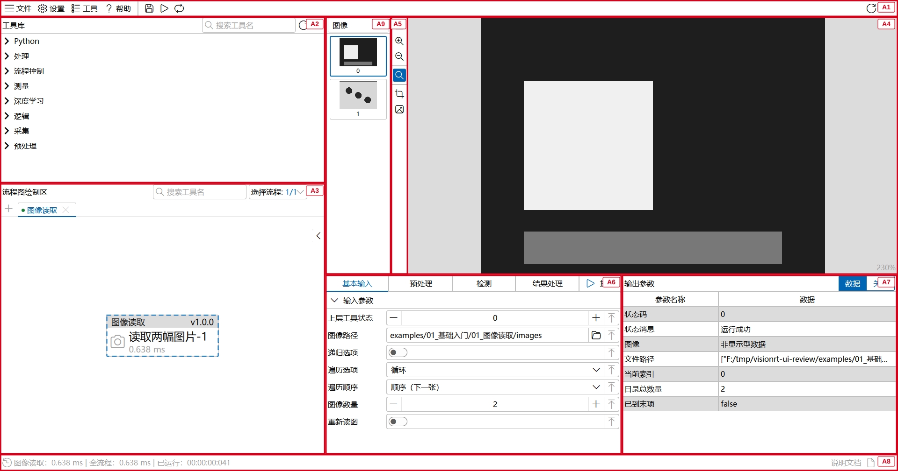

## 样式入口

| 内容 | 唯一配置入口 |
| --- | --- |
| 应用尺寸 | [Size.h](../src/ui/Size.h)，QML 名称 `VisionRTSize` |
| 应用专用颜色 | [Color.h](../src/ui/Color.h)，QML 名称 `VisionRTColor` |
| 枚举和样式注册 | [UiTypes.cpp](../src/ui/UiTypes.cpp)；应用采用 QuickUI 浅色默认调色板 |
| 通用颜色 / 字体 / 图标 | [Color.cpp](../3rdparty/QuickUI/src/Color.cpp) / [Font.cpp](../3rdparty/QuickUI/src/Font.cpp) / [IconsFont.h](../3rdparty/QuickUI/src/include/quickui/IconsFont.h) |

## 尺寸速查

控制属性只列命名样式属性或组件默认值，不列 `Layout`、`anchors` 等布局实现。

| 区域 | 实际值 | 控制属性 / 来源 | 完整图与红框 |
| --- | --- | --- | --- |
| 主窗体 | 启动最大化；本次截图客户区1920 × 1009 | `Window.Maximized`；[Main.qml](../src/ui/qml/Main.qml) | <a href="images/ui-style/quick-main-A0.svg">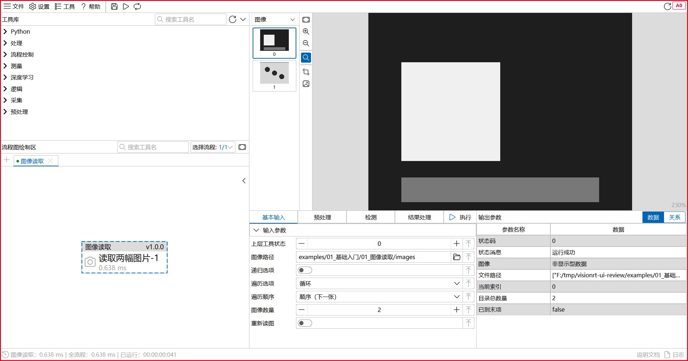</a> |
| 顶部工具栏 | 高36；外框1，贯穿整窗宽度；左右边距5；间距4 | `VisionRTSize.BarSize`；[MainToolbar.qml](../src/ui/qml/MainToolbar.qml) | <a href="images/ui-style/quick-main-A1.svg">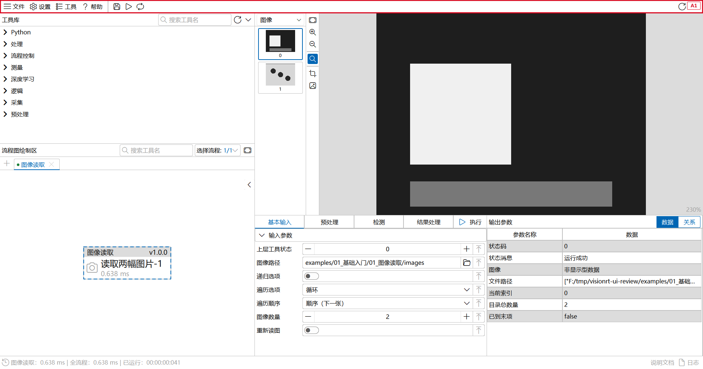</a> |
| 工具栏文字按钮 | 高32；宽按图标和文字计算；左右内边距5；圆角4 | `VisionRTSize.ButtonSize`；[WorkbenchActionButton.qml](../src/ui/qml/WorkbenchActionButton.qml) |  |
| 通用图标按钮 | 28 × 28；图标20；圆角3 | `VisionRTSize.IconButtonSize`；图标默认复用 QuickUI `QuiTextIconButton.iconSize`，覆盖处使用 `VisionRTSize.IconSize` | <a href="images/ui-style/quick-main-A1-A5.svg">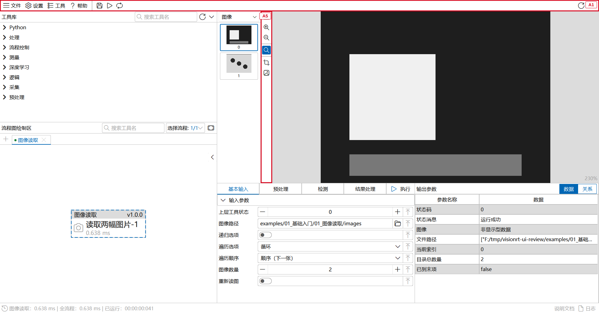</a> |
| 工具栏分隔线 | 竖2 × 32；横32 × 2；顶部左右外边距5 | `VisionRTSize.SeparatorSize`；[WorkbenchSeparator.qml](../src/ui/qml/WorkbenchSeparator.qml) |  |
| 工具库 | 标题高36，底线1；搜索输入高32；树行高32；箭头20；分类和叶子不显示额外图标 | `VisionRTSize.BarSize` / `ContentSize` / `IconSize`；[ToolLibrary.qml](../src/ui/qml/ToolLibrary.qml)、[ToolTreeDelegate.qml](../src/ui/qml/ToolTreeDelegate.qml) | <a href="images/ui-style/quick-main-A2.svg">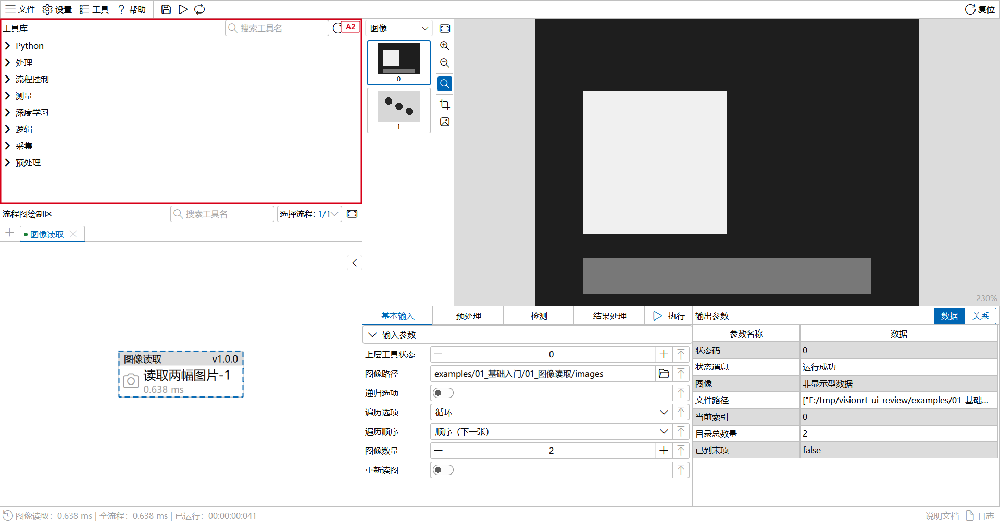</a> |
| 流程工具栏和页签 | 两栏各高36；搜索和下拉框高32；添加/删除按钮28；图标20 | `VisionRTSize.BarSize` / `ContentSize` / `IconButtonSize` / `IconSize`；[FlowToolbar.qml](../src/ui/qml/FlowToolbar.qml)、[FlowTabs.qml](../src/ui/qml/FlowTabs.qml) | <a href="images/ui-style/quick-main-A3.svg">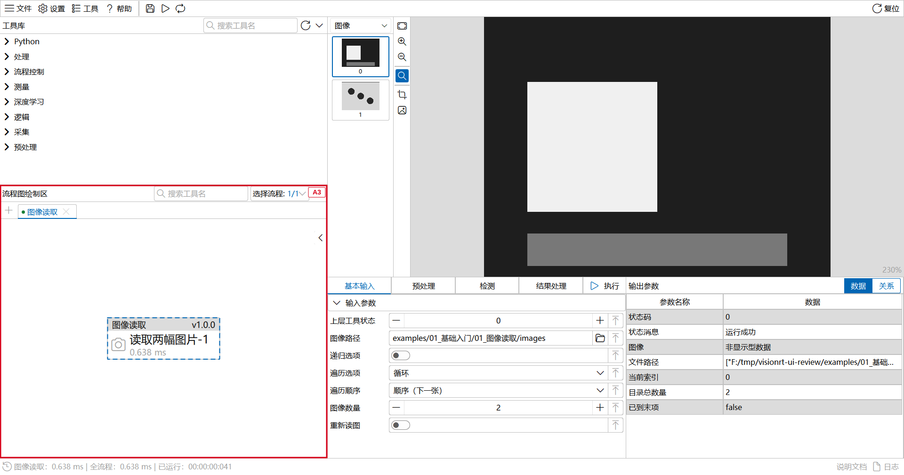</a> |
| 流程节点 | 宽160 × 高60；提示卡宽240；不绘制网格点 | `VisionRTSize.NodeWidth` / `NodeHeight` / `NodeTooltipWidth`；[NodeDelegate.qml](../src/ui/qml/NodeDelegate.qml) | <a href="images/ui-style/quick-training-edges-A3.svg">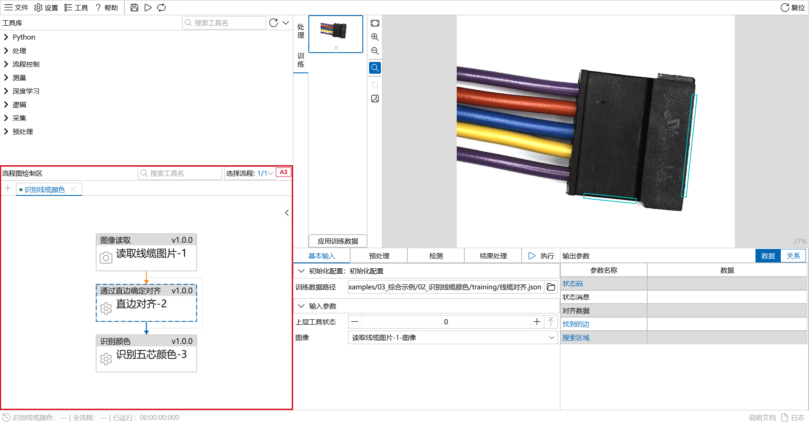</a> |
| 图像竖向工具栏 | 宽36，填满视口可用高度；按钮28；图标20；按钮间距5 | `VisionRTSize.BarSize` / `IconButtonSize` / `IconSize`；[ResultsImageToolbar.qml](../src/ui/qml/ResultsImageToolbar.qml) | <a href="images/ui-style/quick-main-A5.svg">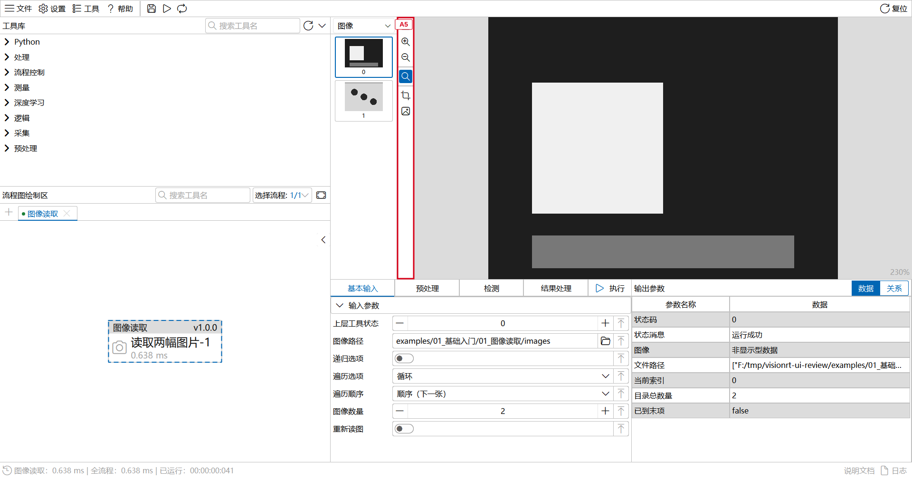</a> |
| 处理图像列表 | 面板宽140；选择图像栏高36、下拉框高32；缩略图图像区高60；序号在底部 | `VisionRTSize.ThumbnailWidth` / `ThumbnailHeight` / `BarSize` / `ContentSize`；[ResultsThumbnails.qml](../src/ui/qml/ResultsThumbnails.qml) |  |
| 训练页签与记录 | 模式条宽36；竖排页签36 × 64；底线2；记录面板宽140；图像区高60；卡片高随内容 | `VisionRTSize.BarSize` / `ContentSize` / `ThumbnailWidth` / `ThumbnailHeight`；[ResultsModeTabs.qml](../src/ui/qml/ResultsModeTabs.qml)、[ResultsTrainingRecords.qml](../src/ui/qml/ResultsTrainingRecords.qml) | <a href="images/ui-style/quick-training-color-T1-T2.svg">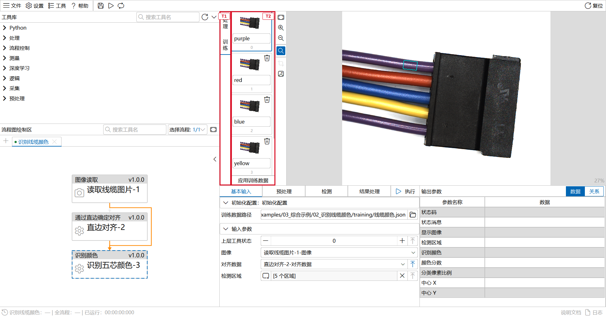</a> |
| 直边训练记录 | 保留一张参考图、底部序号；不显示删除按钮和颜色名称输入 | `VisionRTSize.ThumbnailWidth` / `ThumbnailHeight`；[ResultsTrainingRecords.qml](../src/ui/qml/ResultsTrainingRecords.qml) | <a href="images/ui-style/quick-training-edges-T2.svg">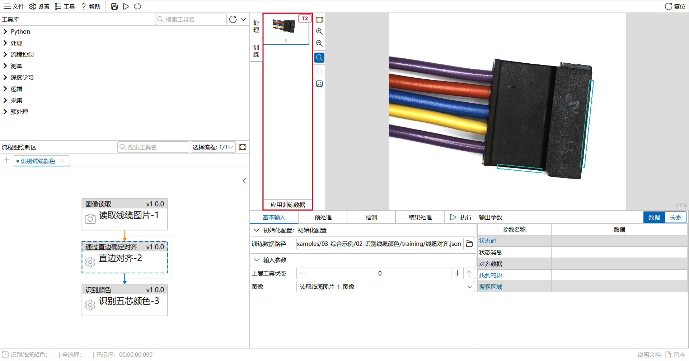</a> |
| 参数页签与执行 | 栏高36；激活/灰底线2；执行80 × 32，图标20 | `VisionRTSize.BarSize` / `ButtonSize` / `IconSize`；[ParameterPanel.qml](../src/ui/qml/ParameterPanel.qml) | <a href="images/ui-style/quick-parameters-A6.svg">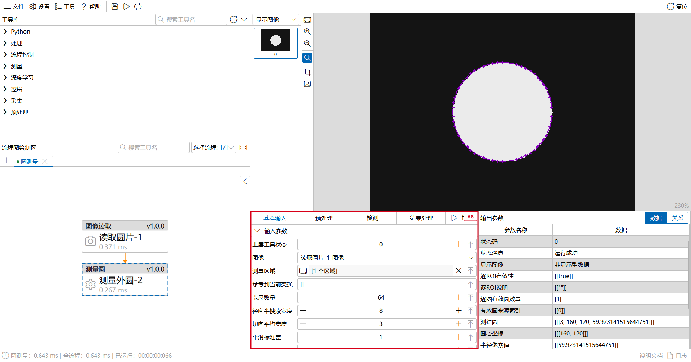</a> |
| 分组折叠栏 | 高36；内边距5；箭头按钮28，图标20 | 调用处覆盖 `QuiExpander.headerHeight` / `headerPadding` / `headerDelegate`，尺寸使用 `VisionRTSize`；QuickUI 默认不改 |  |
| 参数行与字段 | 行高32；标签宽120；输入框高32、圆角4、边框1；字段内按钮32 × 32，图标20；行间距5 | `VisionRTSize.ContentSize` / `ParamLabelWidth` / `IconSize`；[ParameterEditor.qml](../src/ui/qml/ParameterEditor.qml)、[IntegerParameterEditor.qml](../src/ui/qml/IntegerParameterEditor.qml) |  |
| 输出区 | 标题栏高36，栏内底线2；表头和数据行32；数据/关系切换整体120 × 32 | `VisionRTSize.BarSize` / `ContentSize` / `ParamLabelWidth` / `ButtonSize`；[OutputPanel.qml](../src/ui/qml/OutputPanel.qml) | <a href="images/ui-style/quick-parameters-A7.svg">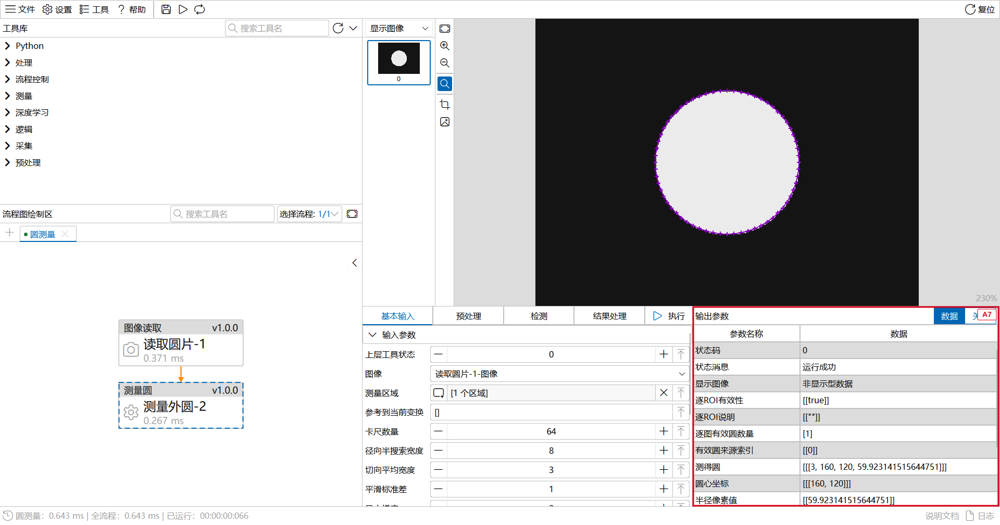</a> |
| 底部状态栏 | 高36；图标按钮28，图标20 | `VisionRTSize.BarSize` / `IconButtonSize` / `IconSize`；[Main.qml](../src/ui/qml/Main.qml) | <a href="images/ui-style/quick-main-A8.svg">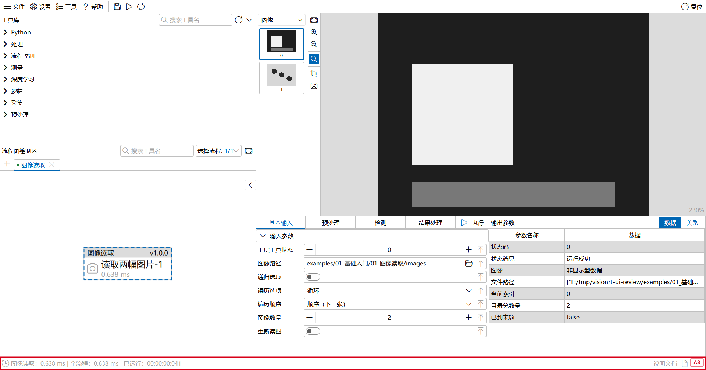</a> |
| 设置窗口 | 初始1280 × 720，可调整大小；导航按钮高32；底部按钮高32；按钮区高42 | 窗口初始值未抽为样式属性；`VisionRTSize.ButtonSize`；[SettingsWindow.qml](../src/ui/qml/SettingsWindow.qml)、[SettingsContent.qml](../src/ui/qml/SettingsContent.qml) | <a href="images/ui-style/quick-settings-S0-S3.svg">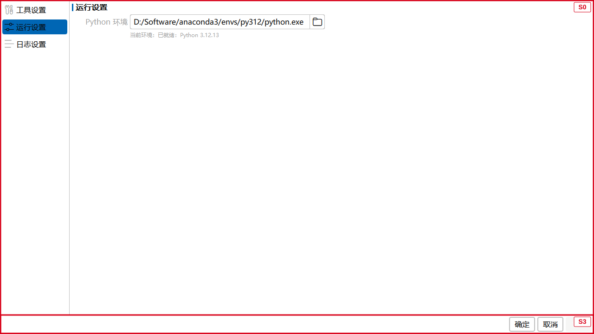</a> |
| 自定义工具窗口 | 初始1280 × 720；四列宽比例2:1:1:1；间距5；分隔线1；按钮高32 | 窗口和列比例为组件配置；`VisionRTSize.ContentSize` / `ButtonSize`；[CustomToolWindow.qml](../src/ui/qml/CustomToolWindow.qml) | <a href="images/ui-style/quick-custom-tool-C1-C2-C3-C4-C5.svg">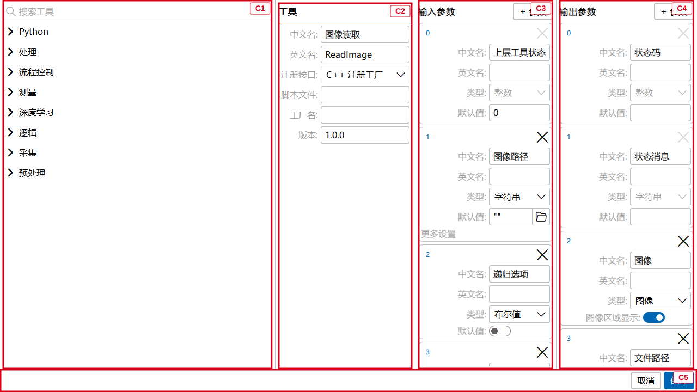</a> |
| 工具信息与端口卡 | 字段高32；端口标签宽120；工具信息标签按文字自然宽度统一对齐；工具卡内外间距5 | `VisionRTSize.ContentSize` / `ParamLabelWidth`；[ToolInformationPane.qml](../src/ui/qml/ToolInformationPane.qml)、[ToolPortsPane.qml](../src/ui/qml/ToolPortsPane.qml)、[ToolPortCard.qml](../src/ui/qml/ToolPortCard.qml) | <a href="images/ui-style/quick-custom-tool-C2-C3-C4.svg">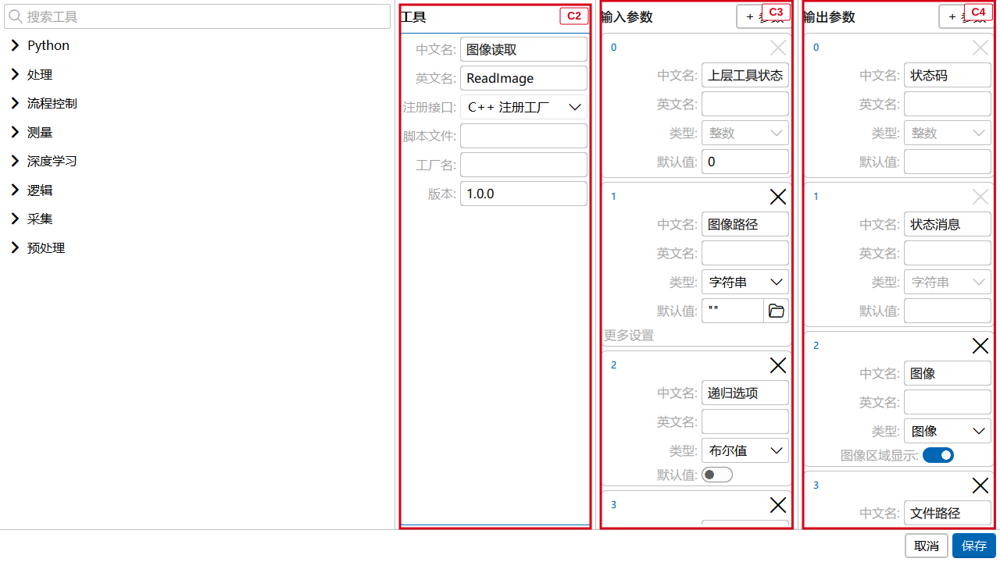</a> |
| 表达式编辑器 | 本场景1080 × 720；按钮高32、字段高32；父级空间上限见组件 | `QuiFont.BodyStrong` / `Body` / `Caption`；`VisionRTSize.ContentSize`；[ExpressionEditor.qml](../src/ui/qml/ExpressionEditor.qml) |  |
| 合流类型编辑器 | 440 × 320；输入和按钮高32；图标20 | `VisionRTSize.ContentSize` / `IconSize`；[SelectTypeEditor.qml](../src/ui/qml/SelectTypeEditor.qml) |  |
| 日志与关于 | 日志初始880 × 420；关于宽度上限600、内容区高度随文本和窗口；按钮高32 | 复用 QuickUI 按钮默认值；[LogDialog.qml](../src/ui/qml/LogDialog.qml)、[AboutVisionRTDialog.qml](../src/ui/qml/AboutVisionRTDialog.qml) |  |

## 字体与颜色

### 字体

| 属性 | 实际字号 / 字重 | 用途 |
| --- | --- | --- |
| `QuiFont.Body` | 16px / 400 | 正文、字段、按钮、树行、页签 |
| `QuiFont.BodyStrong` | 16px / 600 | 区块标题、弹层标题 |
| `QuiFont.Caption` | 12px / 400 | 次要说明、序号、节点辅助信息 |
| `QuiFont.Display` | 68px / 600 | QuickUI 默认字体档位 |
| `QuiFont.Subtitle` | 20px / 600 | QuickUI 默认字体档位 |
| `QuiFont.Title` | 28px / 600 | QuickUI 默认字体档位 |
| `QuiFont.TitleLarge` | 40px / 600 | QuickUI 默认字体档位 |

字体家族继承 Qt 应用默认字体；参数页签、执行按钮、输出标题统一使用 `QuiText` 的原生文字渲染。图标使用 QuickUI 的字体图标资源。原生窗口标题栏遵循系统设置。

### 当前浅色调色板

| 属性 | 实际值 | 来源 |
| --- | --- | --- |
| `QuiColor.Primary` | `#FFFFFF` | [QuickUI Color.cpp](../3rdparty/QuickUI/src/Color.cpp) |
| `QuiColor.Background` | `#DCDCDC` | [QuickUI Color.cpp](../3rdparty/QuickUI/src/Color.cpp) |
| `QuiColor.Border` | `#C0C0C0` | [QuickUI Color.cpp](../3rdparty/QuickUI/src/Color.cpp) |
| `QuiColor.Button` | `#FFFFFF` | [QuickUI Color.cpp](../3rdparty/QuickUI/src/Color.cpp) |
| `QuiColor.Highlight` | `#0066B4` | [QuickUI Color.cpp](../3rdparty/QuickUI/src/Color.cpp) |
| `QuiColor.Error` | `#CF222E` | [QuickUI Color.cpp](../3rdparty/QuickUI/src/Color.cpp) |
| `QuiColor.FontPrimary` | `#070707` | [QuickUI Color.cpp](../3rdparty/QuickUI/src/Color.cpp) |
| `QuiColor.FontCaption` | `#A0A0A0` | [QuickUI Color.cpp](../3rdparty/QuickUI/src/Color.cpp) |
| `QuiColor.FontDark` | `#767676` | [QuickUI Color.cpp](../3rdparty/QuickUI/src/Color.cpp) |
| `QuiColor.White` | `#FFFFFF` | [QuickUI Color.cpp](../3rdparty/QuickUI/src/Color.cpp) |
| `QuiColor.ItemHover` | `#07000000（ARGB）` | [QuickUI Color.cpp](../3rdparty/QuickUI/src/Color.cpp) |
| `QuiColor.ItemPress` | `#0F000000（ARGB）` | [QuickUI Color.cpp](../3rdparty/QuickUI/src/Color.cpp) |
| `QuiColor.ItemDisabled` | `#E1DFDD` | [QuickUI Color.cpp](../3rdparty/QuickUI/src/Color.cpp) |
| `QuiColor.CardBackground` | `#FFFFFF` | [QuickUI Color.cpp](../3rdparty/QuickUI/src/Color.cpp) |
| `QuiColor.CardBorder` | `#E5E5E5` | [QuickUI Color.cpp](../3rdparty/QuickUI/src/Color.cpp) |

半透明颜色在父级表面上合成，不能把其 ARGB 字面值当作截图中的不透明 RGB 色值。

| 应用专用属性 | 实际值 | 来源 |
| --- | --- | --- |
| `VisionRTColor.NodeGreen` | `#1A7F37` | [Color.h](../src/ui/Color.h) |
| `VisionRTColor.NodeOrange` | `#FF8800` | [Color.h](../src/ui/Color.h) |
| `VisionRTColor.InputROI` | `#00BEBE` | [Color.h](../src/ui/Color.h) |
| `VisionRTColor.OutputROI` | `#8800BE` | [Color.h](../src/ui/Color.h) |

### 分区配色速查

| 区域 / 状态 | 属性与实际值 | 完整图与红框 |
| --- | --- | --- |
| 工具栏、工具库、流程工作区、辅助窗口表面 | `QuiColor.Primary` `#FFFFFF`；边界 `QuiColor.Border` `#C0C0C0` | <a href="images/ui-style/quick-main-A1-A2-A3.svg">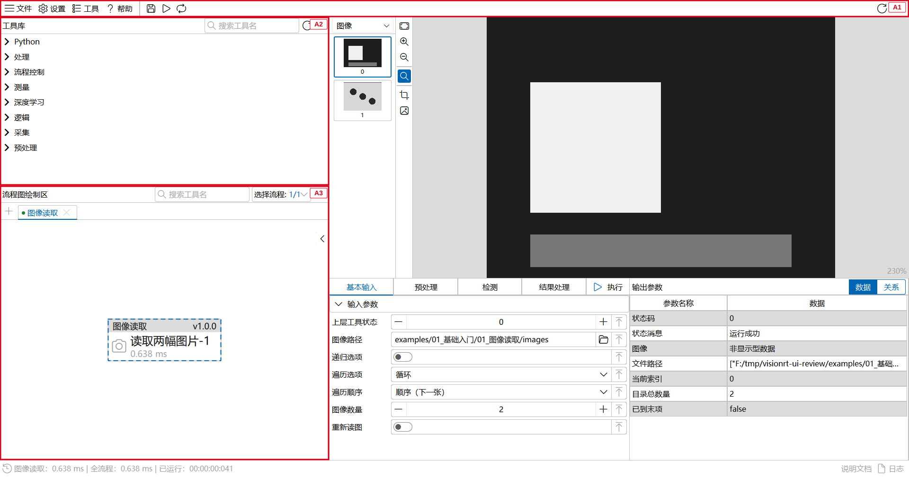</a> |
| 按钮默认 / 悬浮 / 按下 | `QuiColor.Button` `#FFFFFF` / `ItemHover` `#07000000（ARGB）` / `ItemPress` `#0F000000（ARGB）`，使用 QuickUI 默认行为 |  |
| 树选中和悬浮 | `QuiColor.Highlight` `#0066B4`；文字和箭头 `QuiColor.FontPrimary` `#070707` |  |
| 节点主体 / 普通标题 | `QuiColor.Primary` `#FFFFFF` / `QuiColor.Background` `#DCDCDC`；边框 `QuiColor.Border` `#C0C0C0` |  |
| 节点运行 / 报错 | 标题和状态边框：`VisionRTColor.NodeGreen` `#1A7F37` / `QuiColor.Error` `#CF222E`；状态标题文字 `QuiColor.White` |  |
| 连线默认 / 选中输入 / 选中输出 | `QuiColor.Background` `#DCDCDC` / `VisionRTColor.NodeOrange` `#FF8800` / `QuiColor.Highlight` `#0066B4`；直接选中为 Highlight，错误为 Error |  |
| 图像视口背景 | `QuiColor.Background` `#DCDCDC` | <a href="images/ui-style/quick-main-A10.svg">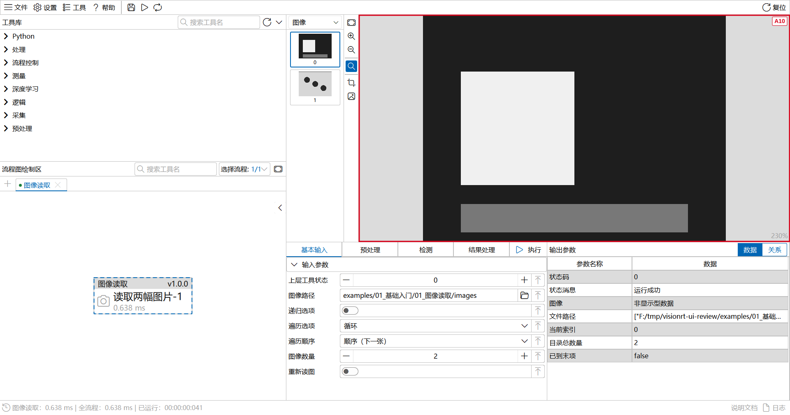</a> |
| 图像列表、竖向工具栏 | `QuiColor.Primary` `#FFFFFF`；选中缩略图边框 `QuiColor.Highlight` `#0066B4` | <a href="images/ui-style/quick-main-A9-A5.svg">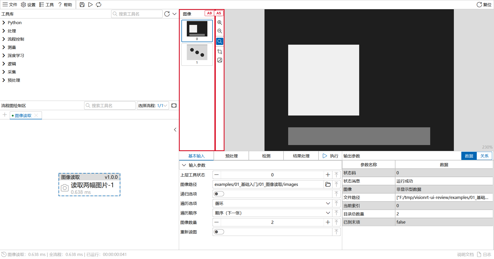</a> |
| 训练页签 | `QuiColor.Primary` `#FFFFFF`；文字 `FontPrimary`；激活底线 `QuiColor.Highlight` `#0066B4`；边界 `QuiColor.Border` `#C0C0C0` | <a href="images/ui-style/quick-training-color-T1.svg">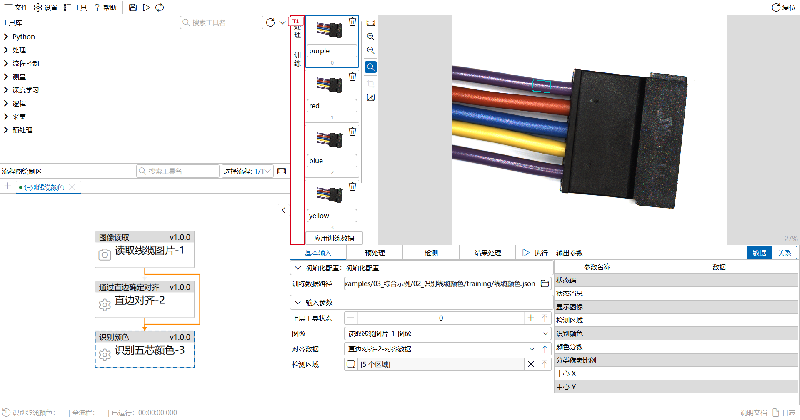</a> |
| 训练记录 | `QuiColor.Primary` `#FFFFFF`；选中边框 `QuiColor.Highlight` `#0066B4`；序号 `FontCaption` `#A0A0A0` | <a href="images/ui-style/quick-training-color-T2.svg">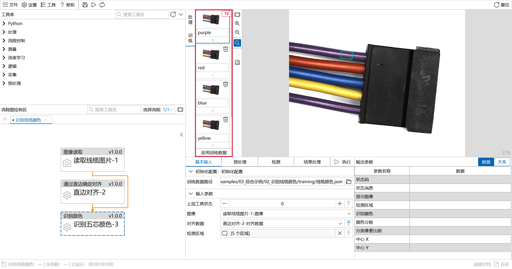</a> |
| 参数页签与字段 | `QuiColor.Primary` `#FFFFFF`；选中文字/底线、字段焦点边框 `QuiColor.Highlight` `#0066B4`；普通边框 `QuiColor.Border` `#C0C0C0` |  |
| 参数上层输入切换 | 上层输入状态图标为 `QuiColor.Highlight` `#0066B4`，手动输入使用普通图标色 | <a href="images/ui-style/quick-training-edges-A6.svg">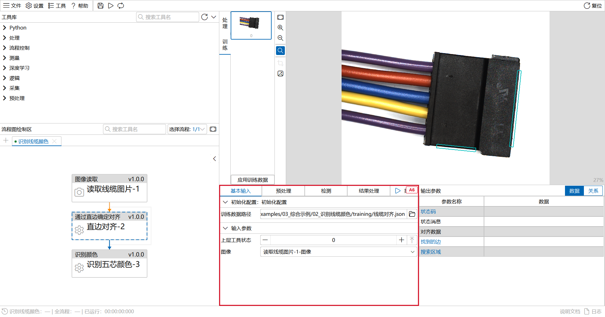</a> |
| 输出区 | 表头 `QuiColor.Primary` `#FFFFFF`；数据行 `QuiColor.Primary` `#FFFFFF` / `QuiColor.Background` `#DCDCDC` 交替；正文 `FontPrimary` |  |
| ROI 与辅助预览 | 输入 / 辅助：`VisionRTColor.InputROI` `#00BEBE`；输出：`VisionRTColor.OutputROI` `#8800BE` | <a href="images/ui-style/quick-training-edges-A10.svg">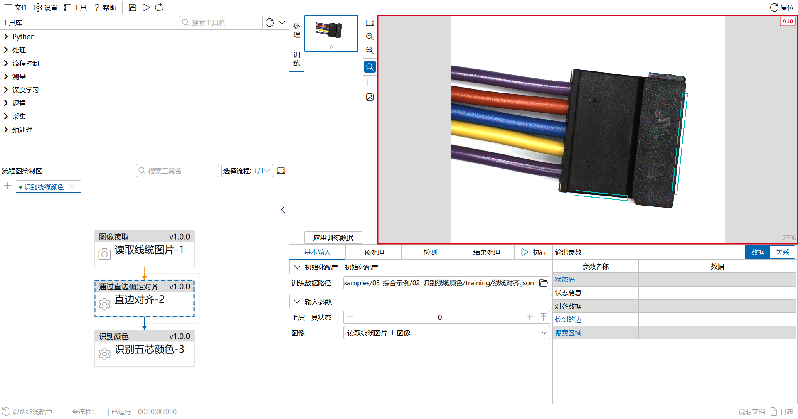</a> |
| 分隔线、可拖动边界 | `QuiColor.Border` `#C0C0C0`；可拖动分隔条悬浮/按下时 `QuiColor.Highlight` `#0066B4` | <a href="images/ui-style/quick-main-A3-A6-A7.svg">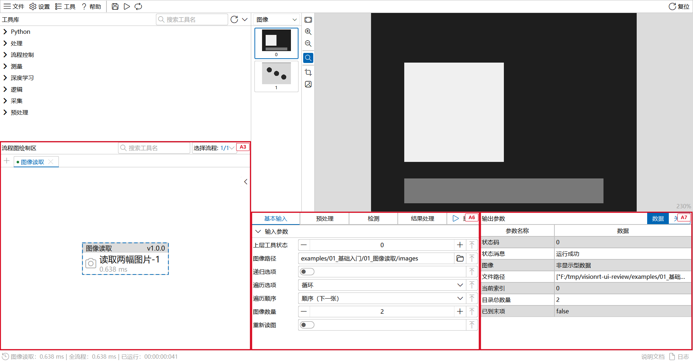</a> |
| 设置与自定义工具 | `QuiColor.Primary` `#FFFFFF`；分隔 `QuiColor.Border` `#C0C0C0`；主文字 `FontPrimary` `#070707`；说明 `FontCaption` `#A0A0A0` | <a href="images/ui-style/quick-settings-S0.svg">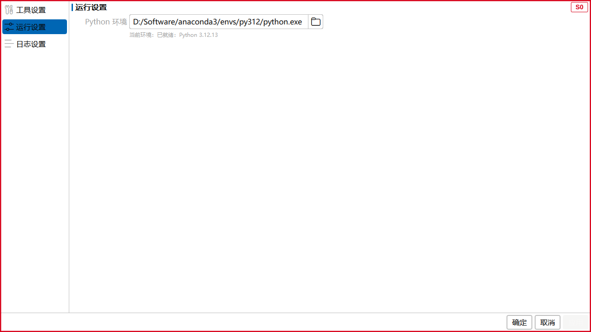</a> |
| 应用与保存按钮 | `QuiFilledButton`；默认背景 Highlight `#0066B4`，文字 White `#FFFFFF`，禁用透明度沿用 QuickUI | <a href="images/ui-style/quick-custom-tool-C5.svg">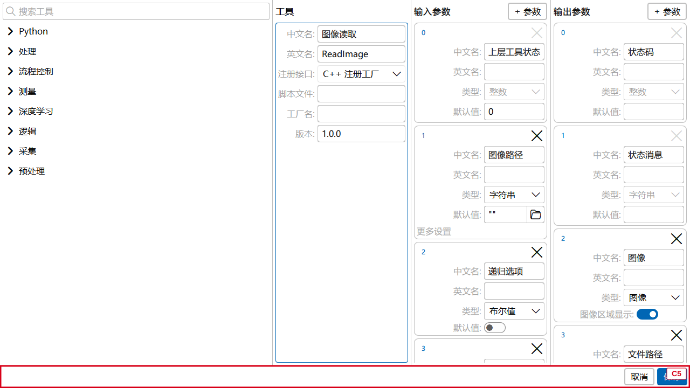</a> |

## 图标码位

以下均为 `QuiFontIcon` 枚举值，来源为 [IconsFont.h](../3rdparty/QuickUI/src/include/quickui/IconsFont.h)。普通图标按钮图标为20px；原生标题栏关闭按钮由系统提供。

| 区域 / 操作 | 枚举属性 | 实际值 |
| --- | --- | --- |
| 文件 | `QuiFontIcon.GlobalNavButton` | `U+E700` / `0xE700` |
| 设置 | `QuiFontIcon.Settings` | `U+E713` / `0xE713` |
| 工具 | `QuiFontIcon.AllApps` | `U+E71D` / `0xE71D` |
| 帮助 | `QuiFontIcon.Help` | `U+E897` / `0xE897` |
| 保存 | `QuiFontIcon.Save` | `U+E74E` / `0xE74E` |
| 执行 | `QuiFontIcon.Play` | `U+E768` / `0xE768` |
| 循环 | `QuiFontIcon.RepeatAll` | `U+E8EE` / `0xE8EE` |
| 停止 | `QuiFontIcon.Stop` | `U+E71A` / `0xE71A` |
| 复位 / 刷新 | `QuiFontIcon.Refresh` | `U+E72C` / `0xE72C` |
| 搜索 / EasyTouch | `QuiFontIcon.Search` | `U+E721` / `0xE721` |
| 适应窗口 / 适应流程 | `QuiFontIcon.FitPage` | `U+E9A6` / `0xE9A6` |
| 放大 | `QuiFontIcon.ZoomIn` | `U+E8A3` / `0xE8A3` |
| 缩小 | `QuiFontIcon.ZoomOut` | `U+E71F` / `0xE71F` |
| ROI 编辑 | `QuiFontIcon.Crop` | `U+E7A8` / `0xE7A8` |
| 1:1 像素显示 | `QuiFontIcon.Photo2` | `U+EB9F` / `0xEB9F` |
| 展开 / 折叠分组 | `QuiFontIcon.ChevronDown` | `U+E70D` / `0xE70D` |
| 折叠分组箭头 | `QuiFontIcon.ChevronRight` | `U+E76C` / `0xE76C` |
| 树向下箭头 | `QuiFontIcon.ChevronDownSmall` | `U+E96E` / `0xE96E` |
| 树向右箭头 | `QuiFontIcon.ChevronRightSmall` | `U+E970` / `0xE970` |
| 添加 | `QuiFontIcon.Add` | `U+E710` / `0xE710` |
| 删除训练记录 | `QuiFontIcon.Delete` | `U+E74D` / `0xE74D` |
| 关闭 / 删除端口 | `QuiFontIcon.Cancel` | `U+E711` / `0xE711` |
| 参数上层输入 | `QuiFontIcon.Upload` | `U+E898` / `0xE898` |
| 路径选择 | `QuiFontIcon.FolderOpen` | `U+E838` / `0xE838` |

| 节点预览（[NodeDelegate](../src/ui/qml/NodeDelegate.qml)） | `QuiFontIcon.Camera` | `U+E722` / `0xE722` |
| 流程选择（[FlowToolbar](../src/ui/qml/FlowToolbar.qml)） | `QuiFontIcon.CheckMark` | `U+E73E` / `0xE73E` |
| 收起工具库（[Main](../src/ui/qml/Main.qml)） | `QuiFontIcon.ChevronLeft` | `U+E76B` / `0xE76B` |
| 上一搜索结果（[FlowToolbar](../src/ui/qml/FlowToolbar.qml)） | `QuiFontIcon.ChevronUp` | `U+E70E` / `0xE70E` |
| 删除端口（[ToolPortCard](../src/ui/qml/ToolPortCard.qml)） | `QuiFontIcon.ChromeClose` | `U+E8BB` / `0xE8BB` |
| 清除搜索或选择（[FlowToolbar](../src/ui/qml/FlowToolbar.qml)） | `QuiFontIcon.Clear` | `U+E894` / `0xE894` |
| 复制日志（[LogDialog](../src/ui/qml/LogDialog.qml)） | `QuiFontIcon.Copy` | `U+E8C8` / `0xE8C8` |
| 工具设置（[SettingsContent](../src/ui/qml/SettingsContent.qml)） | `QuiFontIcon.DeveloperTools` | `U+EC7A` / `0xEC7A` |
| 新建工程（[Main](../src/ui/qml/Main.qml)） | `QuiFontIcon.Document` | `U+E8A5` / `0xE8A5` |
| 编辑参数内容（[ParameterDialogField](../src/ui/qml/ParameterDialogField.qml)） | `QuiFontIcon.Edit` | `U+E70F` / `0xE70F` |
| 运行设置（[SettingsContent](../src/ui/qml/SettingsContent.qml)） | `QuiFontIcon.Equalizer` | `U+E9E9` / `0xE9E9` |
| 目录设置（[SettingsContent](../src/ui/qml/SettingsContent.qml)） | `QuiFontIcon.Folder` | `U+E8B7` / `0xE8B7` |
| 最近工程（[Main](../src/ui/qml/Main.qml)） | `QuiFontIcon.History` | `U+E81C` / `0xE81C` |
| 日志设置（[SettingsContent](../src/ui/qml/SettingsContent.qml)） | `QuiFontIcon.List` | `U+EA37` / `0xEA37` |
| 矩形区域（[ParameterEditor](../src/ui/qml/ParameterEditor.qml)） | `QuiFontIcon.RectangularClipping` | `U+F407` / `0xF407` |
| 数值减少（[QuiStepperField](../3rdparty/QuickUI/src/controls/QuiStepperField.qml)） | `QuiFontIcon.CalculatorSubtract` | `U+E949` / `0xE949` |

## 窗口与模块索引

自定义工具由 [CustomToolWindow](../src/ui/qml/CustomToolWindow.qml) 组合目录、[ToolInformationPane](../src/ui/qml/ToolInformationPane.qml) 和两列 [ToolPortsPane](../src/ui/qml/ToolPortsPane.qml)。草稿与保存入口由 [ToolEditorController](../src/ui/ToolEditorController.h) 持有。

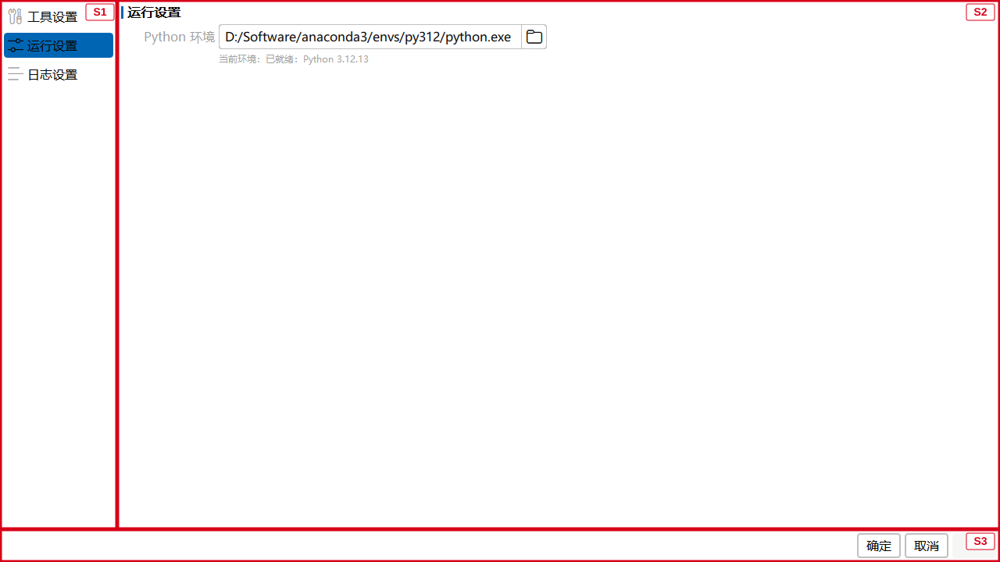

设置窗口持有草稿与应用结果，[SettingsContent](../src/ui/qml/SettingsContent.qml) 通过属性和信号编辑内容。确定、取消、应用共用32px按钮，应用使用 `QuiFilledButton`。

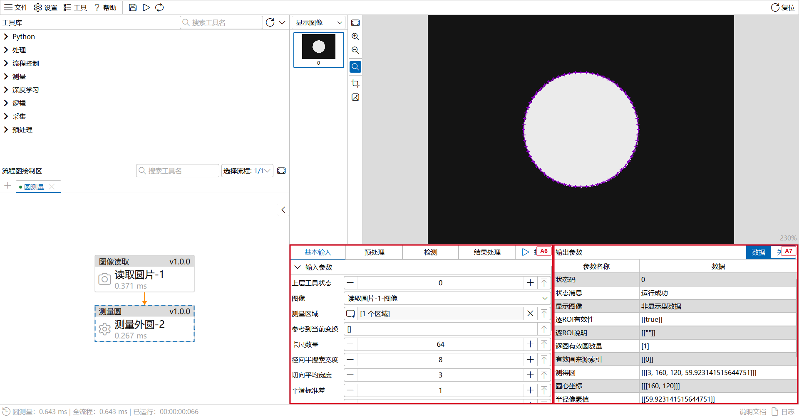

参数控件入口：[ParameterFieldFrame](../src/ui/qml/ParameterFieldFrame.qml)、[ParameterTextField](../src/ui/qml/ParameterTextField.qml)、[ParameterComboBox](../src/ui/qml/ParameterComboBox.qml)、[IntegerParameterEditor](../src/ui/qml/IntegerParameterEditor.qml)、[ParameterDialogField](../src/ui/qml/ParameterDialogField.qml)。原生文件/目录选择器遵循系统样式。

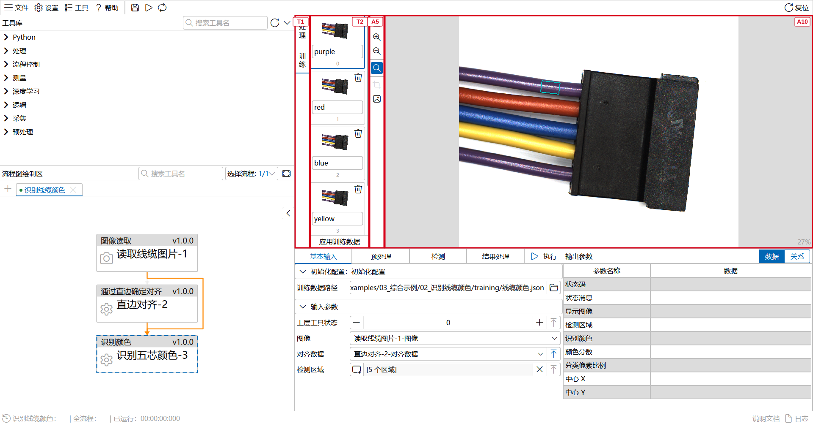

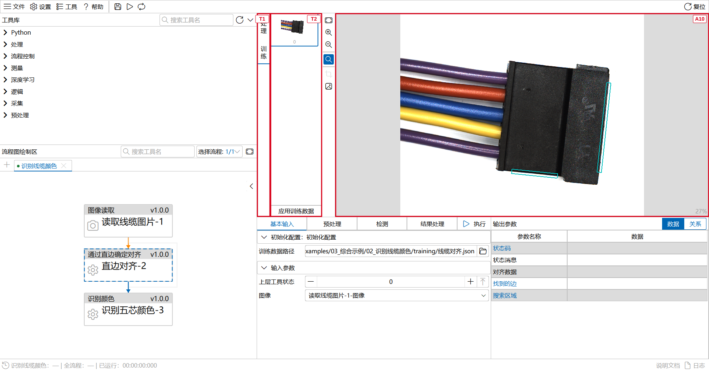

训练视图复用 [ResultsPanel](../src/ui/qml/ResultsPanel.qml) 和图像工具栏；记录列表在 [ResultsTrainingRecords](../src/ui/qml/ResultsTrainingRecords.qml)，训练状态与资产写入在 [TrainingSession](../src/ui/TrainingSession.h)。

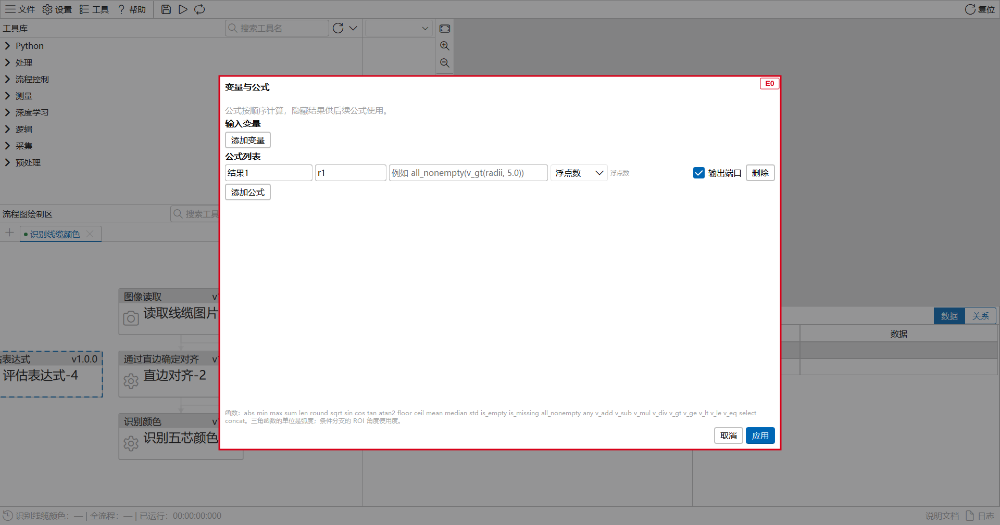

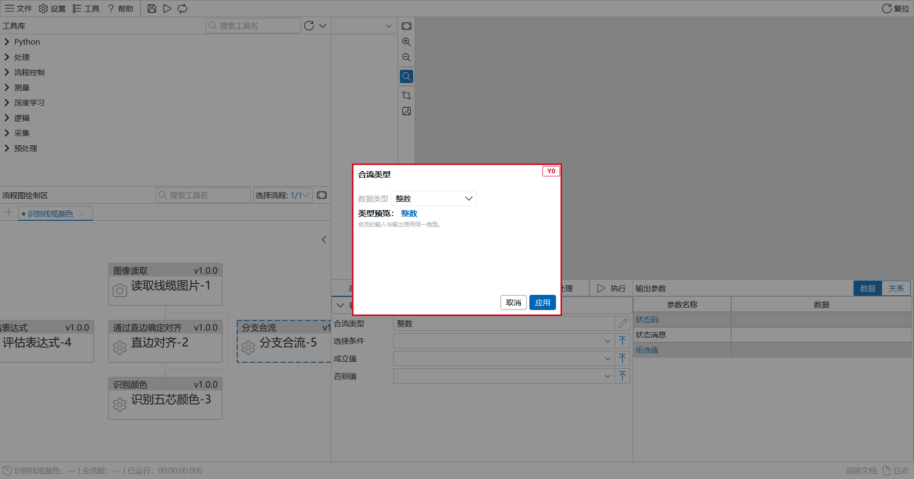

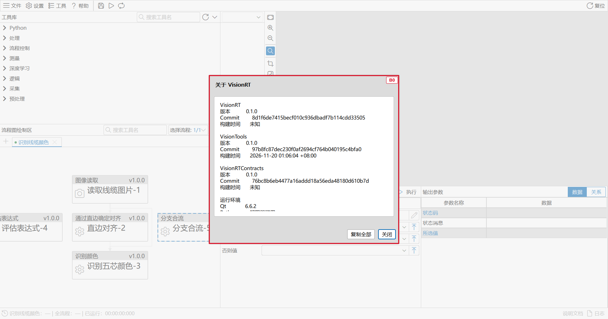

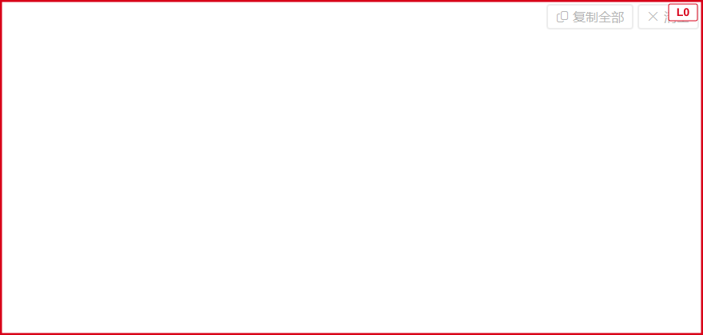

表达式与类型弹层分别在 [ExpressionEditor](../src/ui/qml/ExpressionEditor.qml)、[SelectTypeEditor](../src/ui/qml/SelectTypeEditor.qml)。通用弹层外壳使用 [WorkbenchDialog](../src/ui/qml/WorkbenchDialog.qml)，原生辅助窗口外壳使用 [WorkbenchWindow](../src/ui/qml/WorkbenchWindow.qml)。

## QuickUI 默认值与应用覆盖

| 组件 | QuickUI 默认值 | VisionRT 使用方式 |
| --- | --- | --- |
| `QuiButtonBase` | 高32，`QuiFont.Body` | 保留默认值；应用 `WorkbenchActionButton` 区分32px文字按钮与28px图标按钮 |
| `QuiTextIconButton` | 图标20，圆角4，默认 Button / ItemHover / ItemPress | 28px图标按钮圆角覆盖为3；字段内操作按钮覆盖为32px |
| `QuiExpander` | 头部高45，内边距15，默认箭头12 | 在参数区调用点覆盖36 / 5，并提供28px按钮、20px箭头的头部委托 |
| `QuiStepperField` | 高32，按钮宽28，图标12 | 参数编辑器调用处覆盖按钮宽32、图标20；保留组件默认实现 |
| `QuiTextBoxBackground` | 高32，圆角4，边框1 | 应用字段外壳将边框颜色绑定到 Border / Highlight，尺寸复用既有控件 |
| `QuiTableView` | 表头和行高32；表头四边网格 | [输出区](../src/ui/qml/OutputPanel.qml)使用白色表头委托，只画左右及底边；标题栏统一绘制2px底线 |
| `QuiMenu` | 背景 `QuiColor.Background` `#DCDCDC`，圆角5，`QuiShadow` 阴影 | [文件及工具菜单](../src/ui/qml/Main.qml)直接复用默认值；[组件](../3rdparty/QuickUI/src/controls/QuiMenu.qml) |
| `QuiMenuItem` | 高40；`QuiFont.Body` 16px；文字 `FontPrimary` `#070707`；悬浮背景 `Hovered`，圆角4 | 直接复用默认值；[组件](../3rdparty/QuickUI/src/controls/QuiMenuItem.qml) |

有限状态和持久化字段的源定义见 [ProtocolEnums.h](../3rdparty/VisionRTContracts/include/visionrt/contracts/ProtocolEnums.h)、[UiState.h](../src/ui/UiState.h)、[DefinitionJson.cpp](../src/core/DefinitionJson.cpp)、[ValueJson.cpp](../src/core/ValueJson.cpp)、[ProjectStorage.cpp](../src/core/ProjectStorage.cpp)、[UiPreferences.cpp](../src/ui/UiPreferences.cpp)。QML 枚举由 [export_enums.py](../3rdparty/VisionRTContracts/tools/export_enums.py) 从 C++ 定义导出。
