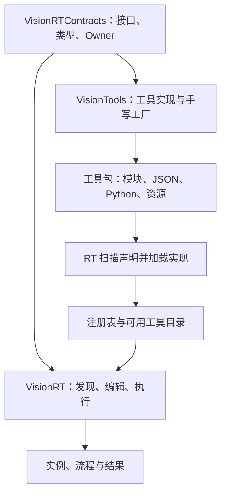
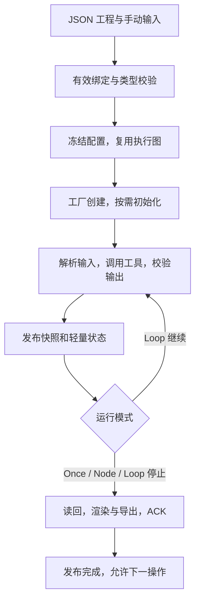
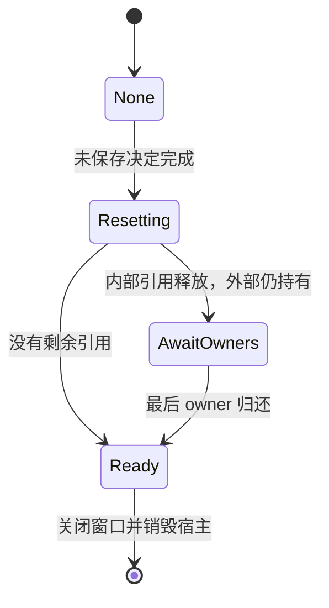

# 完整目标方案

## 1. 职责与依赖

Contracts 定义稳定的工具实例接口、工厂和注册接口、状态、类型、可写数据载体及 Owner。VisionTools 实现算法、手动取参和组装结果、导出手写工厂注册函数、提供 JSON 与 Python 文件。VisionRT 加载模块、扫描并解析 JSON、展示工具、创建实例、管理项目和调度。工具实现不解析自己的声明 JSON，不依赖构建生成器。

跨 DLL 创建与销毁在配对 provider 中完成；持有结果/工厂时保留模块依赖，不能先卸载仍被引用的实现。当前包含 C++ 标准库/OpenCV 类型的 ABI 依赖匹配的编译器、运行库、Contracts 和 OpenCV；ABI 版本检查不等于任意工具链二进制兼容。

## 2. JSON 是唯一用户配置和文本格式

工具声明、工程保存、参数编辑、输出文本和工具包索引均使用 JSON。VisionRT 使用现有 Qt JSON 解析与类型化值编解码；复用当前 schema/version/校验器，不额外引入 YAML 库、第二套 DSL 或从 JSON 生成 C++ 输入输出的系统。

定义包括 tool_id、名称、版本、kind、初始化参数、输入、输出、编辑和显示信息。展示用中文名称与类型；机器 ID 用于注册、持久化和诊断。系统状态输出在宿主统一注入；用户不手写重复声明 __status_*。普通提示原样展示工具 status.message；上下文、异常 detail 保留在显式诊断视图。

保存沿用当前类型化格式；Int64 必须按已有无损编码处理，不能随手经 QJson 的 double 中间值导致超过 2^53 的整数损失。加载校验完整后替换工程；保存成功才清 dirty。不要为本次改进更换 schema。

Python 与 C++ 都从 JSON 出现在工具目录。扫描来源决定 builtin/custom 根，entry 只在指定根内解析；custom 缺文件不能回退到同名 builtin。类式工具 initialize/execute/release 保持现有协议；函数式工具由适配器对接同一工具接口。Python 接收字典/原生列表和 ndarray，手动返回声明输出和状态。

## 3. 数据类型与当前边界

| 对外类型 | C++ | Python | 说明 |
|---|---|---|---|
| 整数 Int | int64_t | int | 按声明校验范围 |
| 浮点 Float | double | float | 不是接受任意隐式数值转换 |
| 布尔 Bool | bool | bool | 不与整数混同 |
| 字符串 String | std::string（UTF-8） | str | 名称和中文显示与机器 ID 分离 |
| 图像 Image | vector<cv::Mat>，由 DataRef<Image> 携带 owner | list[np.ndarray] | 全局只有这一个图像类型；UI 叫“图像” |
| 一维数组 | vector<T>，由 Array/Owner 携带 | list[T_python] | dtype 显式 |
| 二维数组 | vector<vector<T>> | list[list[T_python]] | 允许按当前规则表达非矩形列表 |
| N 维数组 | N 层 vector | N 层 list | 当前实现 rank 为 1～4；超限明确拒绝 |
| ROI | vector<vector<vector<double>>> | list[list[list[float]]] | Python 没有内建 double 类型名称 |

Array 当前 dtype：UInt8、Int32、Int64、Float32、Float64、Bool、String。示例中的“一维字符串数组”来自 String + rank=1；不应把 `Array`、`String` 或 `__status_message` 当作完整中文显示标签。

ROI 外层对应图像，中层为该图像的 ROI 集合，最内层为 `[kind, ...data]`。当前 kind：0 点、1 线段、2 矩形、3 圆、4 多边形、5 点集。矩形例子：`[[[2.0, x, y, width, height, angle]]]`。具体字段、角度和坐标规则以 Contracts 的 ROI 校验/几何函数为唯一来源；不在每个工具另造不兼容编码。

“以此类推”不意味着当前 ABI 支持无限 rank。若需要 rank>4，应作为单独需求评估 variant 模板实例数量和编译成本，当前方案不凭空承诺。

## 4. 可写数据与跨语言所有权

Contracts 不增加 readonly/readwrite 属性，不内置自动复制/COW。RT 传递数据与 owner、保证生命周期，并协调自己的渲染/导出读者；工具自行选择原地修改、复制、新建输出及共享写入协调。

图像零拷贝桥接保持当前专用模块：

- C++→Python：ndarray 视图使用 Mat 数据指针、shape、strides，base capsule 保留 Storage/Owner/Mat；保持可写。
- Python→C++：验证 dtype、形状、列/通道连续、合法正行步长及实际缓冲范围；cv::Mat 头指向 NumPy 数据，UMatData userdata 保留 Storage，使 Mat 浅拷贝和 ROI 视图继承保活。
- 对从 C++ 回来的 ndarray 及子视图，复用可验证的底层 storage，按当前视图重建 Mat 头；不能只因 capsule 名称相同便返回原始尺寸的 Mat。
- 最后一个 native owner 释放时，在 GIL 下归还 Python 引用；解释器必须晚于这些引用销毁。BufferLease RAII 成功获取后恰好释放一次。
- 支持可表示为 Mat 的正行步长 ROI，不要求一律 C-contiguous。负步长、转置、广播等不支持布局明确拒绝；工具明确调用 np.ascontiguousarray 或复制后再返回。桥接不替工具暗中复制。
- 检查实际 ndarray 存储是否可写是保护可写指针真实性，不是给业务数据新增读写权限属性。不能把本来不可写的内存强制标为可写。

零拷贝指**符合条件的图像像素缓冲**。Mat/ndarray/capsule 元数据仍需创建；嵌套 C++ vector 与 Python 原生 list 的转换需要分配和元素映射。不得宣传所有数据、所有布局绝对零拷贝。标量自然对齐也不是 SIMD 16/32/64 字节对齐保证。

## 5. 执行与读回

同一执行轮次有效依赖只来自 Upstream；源结果必须属于正确 generation/session/round，手动运行节点沿用当前已定义的历史结果规则。Stop 阻止后续调度，不能等价于读回 ACK；Reset/Close 排空读者后再释放实例。不同工具共享可写数据时，生命周期安全不自动等于线程安全。

Once/Node 保证展示所需图像、ROI 正常刷新；Loop 只更新耗时、badge、状态颜色、流程时间等。保留上一幅已完成显示可接受，不在循环中逐轮转换/复制/遍历图像与 ROI，不派发逐轮重资源读回。停止后进行最终安全读回。

## 6. 时间口径

底部保持：`流程名：xxx ms | 全流程：xxx ms | 已运行：00:02:34:456`。

| 指标 | 含义 |
|---|---|
| 选中流程 | 该 flow 实际提交至完成的墙钟耗时，不是节点耗时相加 |
| 全流程 | 一轮全部选定 flows 从首次提交前至全部完成后的墙钟，不用求和/取最大替代 |
| 已运行 | 单调时钟从本次会话开始至结束，Loop 连续累积；新会话重新计时 |
| 节点总耗时 | 当前 NodeRuntime 整次边界内墙钟 |
| 工具调用 | adapter execute 边界；Python 包含桥接和等待项，不冒称纯算法时间 |
| 准备/初始化/校验 | 各实际阶段、包含异常退出；未进入显示 —，真实测得 0 可显示 0 |
| 工具预处理/后处理 | 未接入工具指标时为 —；不从宿主阶段伪造 |

全流程时间止于全部计算完成，UI 最终读回不应混入该算法轮耗时；会话结束则按现有 completion/读回完成定义。需要诊断读回延迟时单独观察，不通过改短时间数字掩盖成本。

## 7. 关闭状态机

未保存决定发生在 None；取消不进入不可逆关闭，选择保存成功后才推进。Resetting 停调度、排读者、协调器释放实例和结果；AwaitOwners 保持事件循环等待外部归还；Ready 发一次 closeReady 并保持终态封闭。

终态后不得新建任务、读回、保存、刷新、编辑；等待外部 owner 时不能通过提前 Py_Finalize 或强行清引用“解决”关窗等待。

## 8. 连线和名称菜单

source.y 必须严格小于 target.y；同级、反向、自身连接在候选、提交、加载、执行、移动和粘贴上保持同一规则。Literal 的旧 source 是草稿，不是活动依赖。

输出名称右键直接展示可搜索的“下层工具→输入”菜单，中文类型、已连勾选、占用禁用。名称操作使用声明上下文，不随 publication 更新而失效；查看/复制数据使用结果上下文。候选和提交共享有效绑定状态，不允许菜单可点而被旧草稿拒绝。项目/结构/端口已变则拒绝过期上下文。
