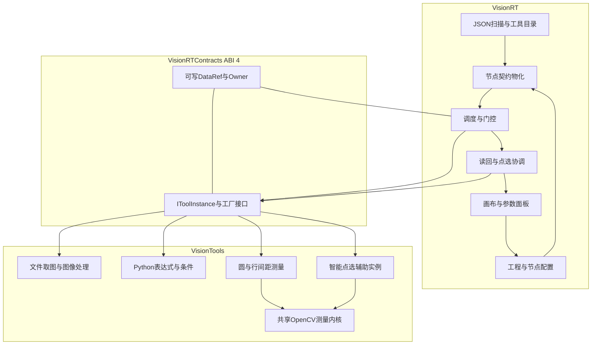
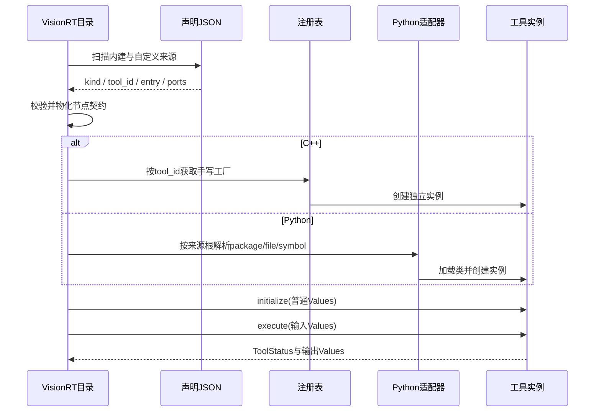
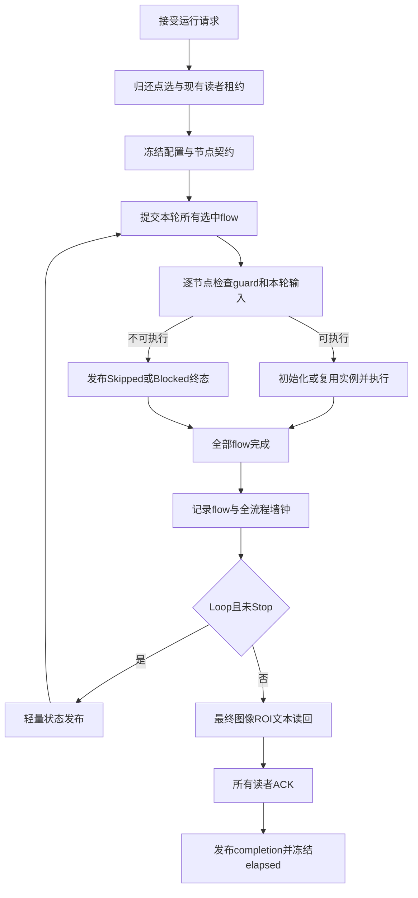
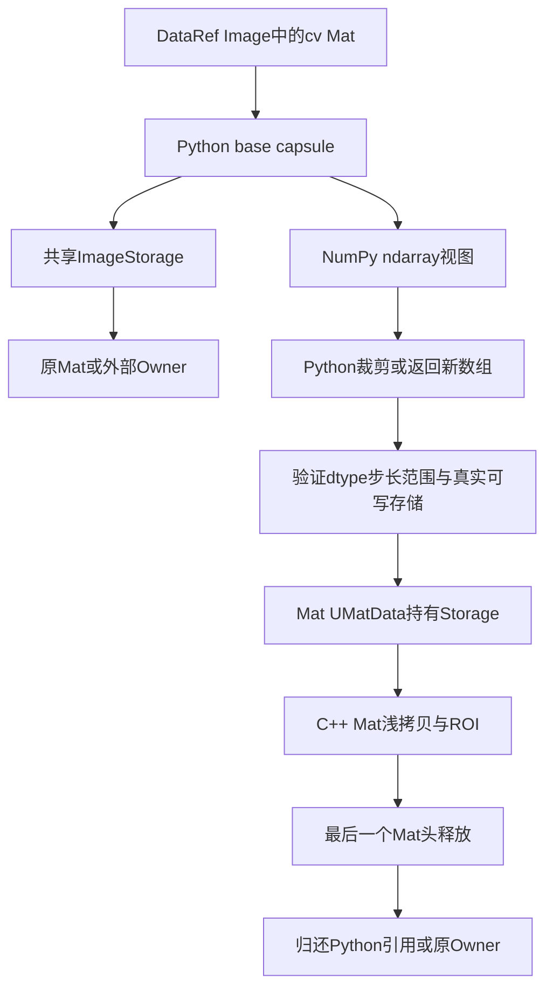
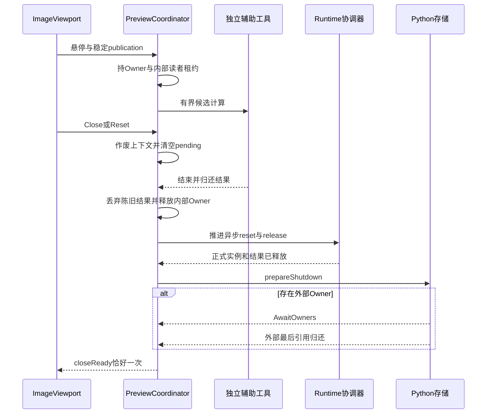

# 架构与时序图

本目录 `diagrams/` 提供 8 张逐工具方案图（SVG矢量原图），`diagrams/index.html` 可离线打开查看全部图。图中文字和连线由结构化图数据绘制，不是AI生成的示意文字。下列Mermaid图提供可编辑的全局架构、调度和生命周期关系。

## 功能架构

JSON由RT读取；注册工厂与算法由Tools实现。辅助工具不创建新的接口体系。图中的所有权连线表示保活关系，不表示数据只读或自动复制。

## 发现与实例化

## Once 与 Loop

## 跨语言图像保活

这是两个传递方向的概念图，不表示应构建强引用环。对回环数组复用已有Storage，并依据返回视图重建Mat头。

## 智能点选与关闭顺序

## 逐工具图索引

| 图 | 对应规范 |
|---|---|
| [01-文件取图.svg](diagrams/01-file-acquisition.svg) | S-IMG-01 |
| [02-旋转图像.svg](diagrams/02-image-rotation.svg) | S-IMG-02 |
| [03-调整亮度.svg](diagrams/03-brightness.svg) | S-IMG-03 |
| [04-评估表达式.svg](diagrams/04-expression.svg) | S-EXPR-01/02 |
| [05-条件分支.svg](diagrams/05-branch.svg) | S-BRANCH-01/02、S-RT-03/04 |
| [06-测量圆.svg](diagrams/06-circle.svg) | S-CIRCLE-01 |
| [07-测量行间距.svg](diagrams/07-row-spacing.svg) | S-ROWS-01 |
| [08-智能点选.svg](diagrams/08-easytouch.svg) | S-ASSIST-01至05 |
