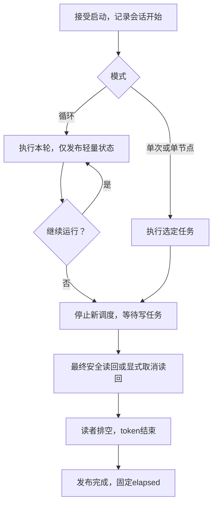

# 完整改进方案

## 架构边界

Contracts只定义工具抽象接口、状态、类型、可写数据载体及所有权/注册协议；不解析JSON，不依赖Qt/Python，不实现只读、自动复制或COW。

VisionTools实现具体C++工具，手写工厂注册并手动组装输入输出，算法/InferRT细节留在工具内；随包附JSON声明。Python工具同样附JSON，业务代码使用原生Python值与NumPy数组。工具选择原地修改、显式复制或创建输出，并协调业务共享写。

VisionRT扫描JSON、加载模块、注册表按名称创建实例、执行流程并传递owner；Qt JSON负责工具声明、工程存储、参数编辑、输出文本。builtin/custom对应各自声明与代码根，Python按kind/entry定位，不扫描.py猜工具。无需生成器，无需再给数据增加访问属性。

## 类型与零拷贝

| 语义 | C++载体 | Python载体 |
|---|---|---|
| 图像（唯一类型） | vector<cv::Mat> | list[np.ndarray] |
| 一维数组 | vector<T> | list[T] |
| N维数组 | N层vector<T> | N层list[T] |
| ROI | vector<vector<vector<double>>> | list[list[list[float]]] |

ROI按图像索引→ROI列表→[类型编号,具体参数…]；每种编号的xywh/angle等布局由唯一ROI协议定义。Python内建float对应这里的double。数组dtype/rank按合同保留，不将列表转换称为零拷贝。

保留现有PythonImages/PythonInterop作为唯一桥接：C++→NumPy的base capsule锚定真实像素owner；NumPy→C++以Mat头和UMatData延长NumPy存储生命周期，Mat浅拷贝和ROI仍保活。外部buffer租约由move-only BufferLease立即接管并持有到最后使用者释放。引用计数延寿，不是自动转移所有权。

支持Mat可表达的H×W/H×W×C布局和行padding，校验dtype、有效stride、边界、溢出、标量对齐；负步长/无法表达的布局明确拒绝，由工具主动整理。无隐式ascontiguousarray、forcecast、写保护、COW。回环使用当前视图地址/shape/stride，不能直接返回旧Mat。像素零拷贝不意味着元数据零分配，也不承诺AVX对齐。

不将shared_ptr<cv::Mat>改成第二套公共Image类型。Type Caster若存在只能薄封装同一桥接，不能引入全局解释器/owner隐式上下文。解释器活过全部Python锚点与释放回调，GIL下DECREF，但不能持GIL阻塞等待需要GIL的释放者。

## 运行与显示的统一协议

单次/单节点：执行后进入安全读回，显示当前工具图像/ROI，所有已执行工具的结果后续均可正常查看；隐藏工具按需显示。Loop：运行持续推进，只轮询/合并轻量状态、时间、badge和颜色；不创建逐轮重读回token，不做新图像转换、ROI几何、全文格式化或业务纹理更新。已有显示缓存独立于继续被工具写入的业务存储。

Stop禁止下一轮，等待真实写任务完成，然后最终读回。Stop不能解除读者屏障；Once/Node/Loop最终阶段共用同一协议。Reset/Refresh/Close同样不能与尚在读结果的UI任务并发释放工具。正常完成只在读者ACK后发布，elapsed也到此必要收尾完成才固定。窗口关闭可不渲染最终画面，但须先取消/排空显示读者再明确取消token。

control锁只保护状态和引用转移；用户工具release、Python、owner析构和通知均在锁外。回调后重新取锁检查谓词，先到ACK也必须被识别。start和完成ACK检查未结束token，避免旧token跨会话。

## 文本信箱与排空

继续使用TextMailbox：成功值或exception_ptr先发布，再queued通知GUI；匹配代次后消费一次。drainReaders是有明确后置条件的屏障：返回时无活跃读者、无可再派发旧请求。进入屏障前冻结派发；已完成显式结果仍交付，剩余排队请求按管理动作完成或明确取消。消费者在屏障内不能递归启动下一项。不要新增后台队列框架，也不要用重复通知或sleep修竞态。

## 关闭状态机

请求关闭先处理未保存决策，批准后进入不可逆Closing；在任何模型清空信号前阻断新运行/编辑/刷新。停止调度、排空读者，经现有coordinator管理命令在锁外释放工具与运行结果，通知GUI清自身快照和显示owner。随后prepareShutdown，检查剩余外部owner；未就绪保持事件循环并说明原因，引用归还后重试。就绪后在所属线程销毁解释器，closeReady只发一次。

删除同步RuntimeEngine::clearResults释放捷径，复用现有manage职责，避免两条销毁通路。外部引用等待不要藏进阻塞GUI的析构。正常关闭不需要额外确认；只有未保存工程沿现有用户决策。

## 三项时间和阶段指标

底部：`流程名：12.35 ms | 全流程：17.80 ms | 已运行：00:02:34:456`。

flow耗时为其实际执行墙钟；全流程为一轮所有参与flow实际起止墙钟，不能sum/max，不包含最终UI读回。会话elapsed从启动被接受到必要收尾完成，运行时now-start，循环持续累加，结束后freeze。首次轮外准备也被elapsed覆盖。未测round为optional空，真实0合法；换工程清空，小时不按24取模。

工具调用与纯算法耗时分开；宿主准备、初始化、工具Adapter调用、输出校验按真实字段显示并区分是否测量。算法内部预后处理未上报就—；不能把宿主时间冒名顶替，也不能把Python桥接子阶段再加进已包含它们的adapter总值。

## 连接与菜单

唯一有效依赖规则：同flow、源与目标存在、端口存在、完整类型兼容、source.y < target.y，不允许同级/向上/自身。有效来源由BindingMode决定；Literal中保留的旧来源不是运行依赖。候选/提交/加载诊断/执行前/临时移动坐标均消费相同BindingCheck。Storage负责解析和迁移，不另定义连接规则。非法有效边保留可修复诊断，禁止执行，不偷偷把已损坏工程说成正常。

输出名称区域直接搜索“下层工具→兼容输入”菜单；数据区域保留查看/复制。DeclarationContext只绑定定义身份，ResultContext增加publication；类型展示统一displayTypeName，机器类型留JSON与逻辑。普通工具错误原样显示message，节点/堆栈/detail仅显式诊断。

## 验证和交付

先修B01/B02，再落实B03～B06；保留已有正确实现与界面外观。复用现有测试目标补barrier边界和真实安装链路，无需新的测试框架。76项已通过测试继续保留；仅新增能区别错误和正确实现的用例。安装验收使用真实E盘目录和干净PATH，TEMP/TMP及测试scratch在D盘。先消除必需依赖缺失，再给生产可用结论。
