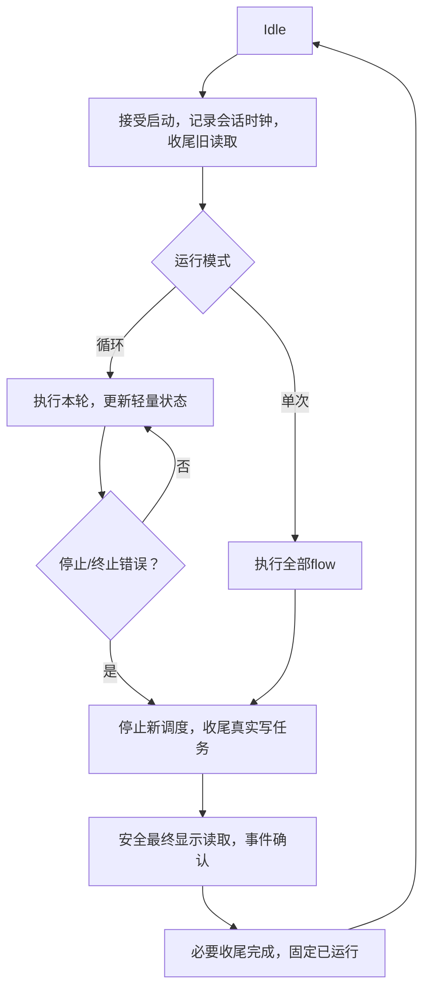

# 实施Specs

| ID | MUST行为 | 代码落点 | 拒绝的实现方式 |
|---|---|---|---|
| S01 | Loop每轮只提交最新轻量状态；GUI不参与推进下一轮 | RuntimeEngine、AppControllerReadback/Display/Roi | 仅不显示控件但后台照常转换；每轮ACK |
| S02 | 单次和停止最终读回及时通知，文本完成通知，锁外回调、匹配token | RuntimeEngine回调、AppControllerReadback | 依赖34ms轮询解锁；control锁内回调 |
| S03 | now-start持续elapsed，完成后freeze；同轮flow/total身份一致 | RuntimeEngine/DurationText/UI | 累加flow或tick；只轮末更新 |
| S04 | 换工程清空时钟缓存；新session清elapsed；Missing不同于0 | clearResults/start/poll | map[]用0冒充未记录；>0过滤合法0 |
| S05 | 连接规则统一：同flow、source.y<target.y、完整类型兼容 | ProjectEditor、ProjectStorage、Runtime | 只拦QML/菜单；只查环 |
| S06 | 临时布局事务验证移动/粘贴；旧非法工程保留可修复、不可执行 | ProjectEditor/storage | 静默清边、部分提交 |
| S07 | 名称直接级联，搜索、顺序、勾选、占用一致；声明上下文不依赖publication | OutputPanel、Bindings | parent.parent推断业务节点；重复候选逻辑 |
| S08 | typeDisplay唯一格式器，普通名称tooltip无机器ID | UI类型模块/各模型/QML | 中文值进入机器type比较 |
| S09 | 有效message原文；detail仅显式诊断 | Diagnostics/OutputModel | tooltip追加detail/节点上下文 |
| S10 | 关闭先停新任务/锚点、释放内部值、检查剩余、就绪才析构 | PythonRuntime/Storage、UI关闭状态 | 析构无限等待作为唯一预检；强制finalize |
| S11 | 依赖租约的buffer持有Py_buffer到最后使用，GIL下释放；或明确拒绝 | PythonImages/ImageStorage | 获取地址后立刻Release却泛称稳定 |
| S12 | 已测准备/初始化/调用/校验清晰分项；adapter不等于算法 | DurationText/Snapshot | 未测项伪造0；嵌套时间重复求和 |
| S13 | 简化封装并保持公开合同、手写工厂、真实容器 | core/ui/python/Contracts | 为用模式引入通用框架、深继承、std::any |

## 状态机和数据读取

图像与ROI显示属于同一publication；循环中冻结画面不要求与不断更新的工具耗时同轮。每节点只保留最新逻辑结果及必要显示缓存，不保存每轮历史。禁止UI并行遍历正在被工具改写的vector/ROI/pixels。业务共享写协调仍归工具，RT只管理自身读取阶段和owner。

## 连接校验函数建议

提供内部值类型`BindingCheck{reason}`与`validateBinding(flow, source, target, positions)`，正常返回成功，错误枚举集中转中文；不需要虚类。枚举足以表示Self/SameOrUpperRow/MissingPort/TypeMismatch/OtherFlow等。候选过滤与命令错误共用；加载把失败转诊断保留引用；执行把失败作为启动错误。candidate查询区分可连接、已连当前输出、占用其他来源，避免先筛掉已连接再计算勾选。

若为提高候选效率复用nodeId→Node索引，在单次查询/校验中构建即可；不引入复杂跨revision缓存。合法严格向下图天然无环，但保留入口级损坏图诊断；避免每一个候选端口都重建整个图再查环，优化前后候选集合必须相同。

## 生命周期和异常

保留unique_ptr单一所有权、shared_ptr用于真正共享payload/module/Python锚点。锁内只变更元数据，不执行Python/DECREF/用户回调。引用释放不抛异常；关闭就绪必须在冻结新调用之后判定，避免check-then-finalize竞争。

DataRef仍返回可写T&，不添加访问属性。模板用requires约束真实合法类型；公共动态插件接口使用虚函数与create/destroy边界，不用模板取代运行时多态。RT与Tools使用匹配工具链/STL/OpenCV二进制依赖，不能把现有C++ ABI宣称为任意编译器通用ABI。
