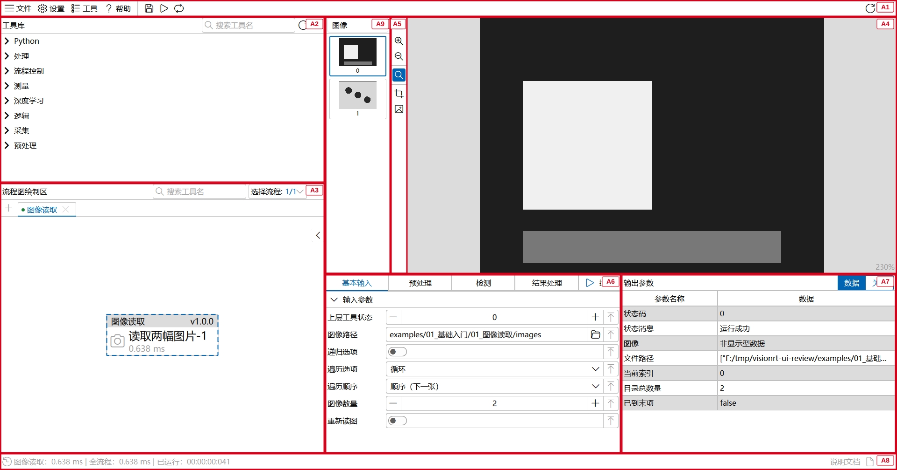

| 红框编号 | 对应区域                 |
| -------- | ------------------------ |
| A0       | 主窗体客户区             |
| A1       | 顶部主工具栏             |
| A2       | 工具库与分类树           |
| A3       | 流程标题、页签与画布     |
| A4       | 图像结果区域             |
| A5       | 图像竖向工具栏           |
| A6       | 参数页签、执行及参数内容 |
| A7       | 输出参数与数据／关系     |
| A8       | 底部状态栏               |

删掉 Theme.h/Theme.cpp 将 VisionRT 的样式拆开 Color.h、Size.h

定义类 VisionRTColor，参考 QuickUI 的 Color.h 的 QuiColor

将 VisionRT 的大部分颜色样式 使用 QuiColor，少量特例使用 VisionRTColor

| 颜色   | 名称       |
| ------ | ---------- |
| 1A7F37 | NodeGreen  |
| FF8800 | NodeOrange |
| 00BEBE | InputROI   |
| 8800BE | OutputROI  |
|        |            |

| 区域                             | 颜色                                                         | 备注                 |
| -------------------------------- | ------------------------------------------------------------ | -------------------- |
| 顶部主工具栏背景                 | QuiColor.Primary                                             |                      |
| 顶部主工具栏边框                 | QuiColor.Border                                              |                      |
| 顶部主工具栏按钮                 | 默认：QuiColor.Button，悬浮时：QuiColor.ItemHover            |                      |
| 顶部主工具栏图标按钮             | 默认：QuiColor.Button，悬浮时：QuiColor.ItemHover            | 组件默认             |
| 顶部主工具栏分割线               | QuiColor.Border                                              |                      |
| 顶部主工具栏复位按钮             | 默认：QuiColor.Button，悬浮时：QuiColor.ItemHover            |                      |
| 顶部工具栏底线                   |                                                              | 删掉，不要底线       |
|                                  |                                                              |                      |
| 工具库标题栏/工具库主体          | QuiColor.Primary                                             |                      |
| 工具库标题栏/工具库主体边框      | QuiColor.Border                                              |                      |
| 工具树箭头                       | QuiColor.FontPrimary                                         | 组件默认             |
| 工具树图标                       | QuiColor.FontPrimary                                         | 组件默认             |
| 工具树选中 / 悬浮                | QuiColor.Highlight                                           |                      |
|                                  |                                                              |                      |
| 流程区标题栏/主体                | QuiColor.Primary                                             |                      |
| 流程区标题栏/主体边框            | QuiColor.Border                                              |                      |
| 流程网格点                       |                                                              | 删掉，不要绘制网格点 |
| 流程节点主体                     | QuiColor.Primary                                             |                      |
| 流程节点标题                     | QuiColor.Background，运行时：NodeGreen，报错：QuiColor.Error |                      |
| 流程节点边框                     | QuiColor.Border，运行时：NodeGreen，报错：QuiColor.Error     |                      |
| 流程节点连线                     | 默认 QuiColor.Background，选中时，输入 NodeOrange，输出：QuiColor.Highlight |                      |
|                                  |                                                              |                      |
| 图像结果区域背景                 | QuiColor.Background                                          |                      |
| 图像竖向工具栏                   | QuiColor.Primary                                             |                      |
| 图像结果区域缩略图区域           | QuiColor.Primary                                             |                      |
| 图像结果区域选择图像下拉列表区域 | QuiColor.Primary                                             |                      |
| 图像结果区域边框                 | QuiColor.Border                                              |                      |
|                                  |                                                              |                      |
| 参数页签、执行及参数内容区域     | QuiColor.Primary                                             |                      |
| 参数页签                         | 文字、底线 QuiColor.Highlight                                |                      |
| 参数页签边框                     | QuiColor.Border                                              |                      |
| 参数框                           | QuiColor.Border，选中时 QuiColor.Highlight                   |                      |
| 参数切换上层输入图标             | 手动输入时：默认，上层输入：QuiColor.Highlight               |                      |
|                                  |                                                              |                      |
| 输出栏主体                       | QuiColor.Primary                                             |                      |
| 输出参数                         | QuiColor.Primary、QuiColor.Background 交替                   |                      |
|                                  |                                                              |                      |
| 辅助窗口                         | QuiColor.Primary                                             |                      |
|                                  |                                                              |                      |
| 主文字 / 次要说明                | QuiColor.FontPrimary，QuiColor.FontCaption                   |                      |
| 分割线                           | QuiColor.Border                                              |                      |
| 区域分割线                       | QuiColor.Border，可 hovered/pressed 时 QuiColor.Highlight    | 可拖动的 SplitHandle |
| QuickUI 组件                     |                                                              | 使用默认值           |

Size.h

定义类 VisionRTSize，参考 QuickUI 的 Color.h 的 QuiColor

| 大小 | 名称           |
| ---- | -------------- |
| 36   | BarSize        |
| 32   | ButtonSize     |
| 28   | IconButtonSize |
| 20   | IconSize       |
| 32   | SeparatorSize  |
|      |                |

| 区域                 | 大小                               | 名称 |
| -------------------- | ---------------------------------- | ---- |
| 主窗体               | 全屏                               |      |
|                      |                                    |      |
| 顶部主工具栏         | BarSize                            |      |
| 顶部主工具栏按钮     | 按钮 ButtonSize、图标  IconSize    |      |
| 顶部主工具栏图标按钮 | 按钮 IconButtonSize、图标 IconSize |      |
| 顶部主工具栏分割线   | SeparatorSize                      |      |
| 顶部主工具栏复位按钮 | 按钮 ButtonSize、图标  IconSize    |      |
|                      |                                    |      |
|                      |                                    |      |
|                      |                                    |      |
| 主文字 / 次要说明    | QuiFont.FontBody / QuiFont.Caption |      |
|                      |                                    |      |
