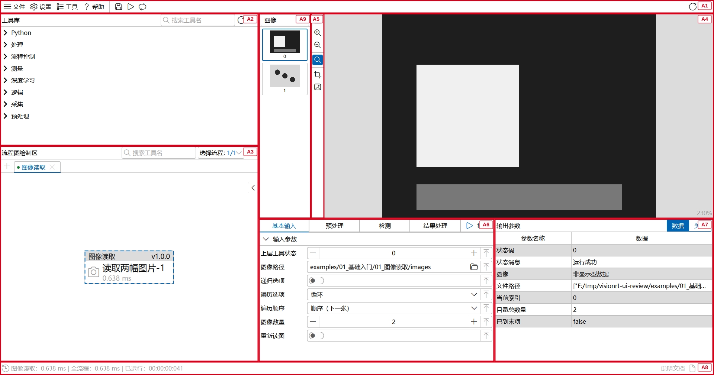

| 红框编号 | 对应区域                 |
| -------- | ------------------------ |
| A0       | 主窗体客户区             |
| A1       | 顶部主工具栏             |
| A2       | 工具库与分类树           |
| A3       | 流程标题、页签与画布     |
| A4       | 图像结果区域             |
| A5       | 图像竖向工具栏           |
| A6       | 参数页签、执行及参数内容 |
| A7       | 输出参数与数据／关系     |
| A8       | 底部状态栏               |

删掉 Theme.h/Theme.cpp 、ui/style/*.qml

将 VisionRT 的样式拆开 Color.h、Size.h

定义类 VisionRTColor，参考 QuickUI 的 Color.h 的 QuiColor

将 VisionRT 的大部分颜色样式 使用 QuiColor，少量特例使用 VisionRTColor

| 颜色   | 名称       |
| ------ | ---------- |
| 1A7F37 | NodeGreen  |
| FF8800 | NodeOrange |
| 00BEBE | InputROI   |
| 8800BE | OutputROI  |
|        |            |

| 区域                             | 颜色                                                         | 备注                 |
| -------------------------------- | ------------------------------------------------------------ | -------------------- |
| 顶部主工具栏背景                 | QuiColor.Primary                                             |                      |
| 顶部主工具栏边框                 | QuiColor.Border                                              | 1px完整外框，覆盖整窗宽度 |
| 顶部主工具栏按钮                 | 默认：QuiColor.Button，悬浮时：QuiColor.ItemHover            |                      |
| 顶部主工具栏图标按钮             | 默认：QuiColor.Button，悬浮时：QuiColor.ItemHover            | 组件默认             |
| 顶部主工具栏分割线               | QuiColor.Border                                              |                      |
| 顶部主工具栏复位按钮             | 默认：QuiColor.Button，悬浮时：QuiColor.ItemHover            |                      |
|                                  |                                                              |                      |
| 工具库标题栏/工具库主体          | QuiColor.Primary                                             |                      |
| 工具库标题栏/工具库主体边框      | QuiColor.Border                                              |                      |
| 工具树箭头                       | QuiColor.FontPrimary                                         | 组件默认             |
| 工具树图标                       |                                                              | 删掉，不要图标       |
| 工具树选中 / 悬浮                | QuiColor.Highlight                                           |                      |
|                                  |                                                              |                      |
| 流程区标题栏/主体                | QuiColor.Primary                                             |                      |
| 流程区标题栏/主体边框            | QuiColor.Border                                              |                      |
| 流程网格点                       |                                                              | 删掉，不要绘制网格点 |
| 流程节点主体                     | QuiColor.Primary                                             |                      |
| 流程节点标题                     | QuiColor.Background，运行时：NodeGreen，报错：QuiColor.Error |                      |
| 流程节点边框                     | QuiColor.Border，运行时：NodeGreen，报错：QuiColor.Error     |                      |
| 流程节点连线                     | 默认 QuiColor.Background，选中时，输入 NodeOrange，输出：QuiColor.Highlight |                      |
|                                  |                                                              |                      |
| 图像结果区域背景                 | QuiColor.Background                                          |                      |
| 图像竖向工具栏                   | QuiColor.Primary                                             |                      |
| 图像结果区域缩略图区域           | QuiColor.Primary                                             |                      |
| 图像结果区域选择图像下拉列表区域 | QuiColor.Primary                                             |                      |
| 图像结果区域边框                 | QuiColor.Border                                              |                      |
| 图像结果区域图像列表             | 选中边框 QuiColor.Highlight                                  |                      |
| 训练模式页签                     | 不再整体高亮 QuiColor.Highlight，而是和参数区域页签一样，底线2px。边框/分割线 QuiColor.Border； |                      |
| 训练模型页签文字                 | 文字 QuiColor.FontPrimary                                    |                      |
|                                  |                                                              |                      |
| 参数页签、执行及参数内容区域     | QuiColor.Primary                                             |                      |
| 参数页签                         | 文字、底线 QuiColor.Highlight                                |                      |
| 参数页签边框                     | QuiColor.Border                                              |                      |
| 参数框                           | QuiColor.Border，选中时 QuiColor.Highlight                   |                      |
| 参数切换上层输入图标             | 手动输入时：默认，上层输入：QuiColor.Highlight               |                      |
|                                  |                                                              |                      |
| 输出栏主体                       | QuiColor.Primary                                             |                      |
| 输出参数                         | QuiColor.Primary、QuiColor.Background 交替                   |                      |
|                                  |                                                              |                      |
| 辅助窗口                         | QuiColor.Primary                                             |                      |
|                                  |                                                              |                      |
| 主文字 / 次要说明                | QuiColor.FontPrimary，QuiColor.FontCaption                   |                      |
| 分割线                           | QuiColor.Border                                              |                      |
| 区域分割线                       | QuiColor.Border，可 hovered/pressed 时 QuiColor.Highlight    | 可拖动的 SplitHandle |
| QuickUI 组件                     |                                                              | 使用默认值           |

Size.h

定义类 VisionRTSize，参考 QuickUI 的 Color.h 的 QuiColor

| 大小 | 名称             |
| ---- | ---------------- |
| 36   | BarSize          |
| 32   | ButtonSize       |
| 28   | IconButtonSize   |
| 20   | IconSize         |
| 32   | SeparatorSize    |
| 32   | ContentSize      |
| 160  | NodeWidth        |
| 60   | NodeHeight        |
| 240  | NodeTooltipWidth |
| 140  | ThumbnailWidth   |
| 60   | ThumbnailHeight  |
| 120  | ParamLabelWidth  |
|      |                  |

| 区域                     | 大小                                                         | 名称                                            |
| ------------------------ | ------------------------------------------------------------ | ----------------------------------------------- |
| 主窗体                   | 启动最大化，100%系统缩放                                                         |                                                 |
|                          |                                                              |                                                 |
| 顶部主工具栏高           | BarSize                                                      |                                                 |
| 顶部主工具栏按钮         | 按钮高 ButtonSize、图标  IconSize                            |                                                 |
| 顶部主工具栏图标按钮     | 按钮 IconButtonSize、图标 IconSize                           |                                                 |
| 顶部主工具栏分割线       | SeparatorSize                                                |                                                 |
| 顶部主工具栏复位按钮     | 按钮 ButtonSize、图标  IconSize                              |                                                 |
|                          |                                                              |                                                 |
| 工具库标题高             | BarSize                                                      |                                                 |
| 工具树行高               | ContentSize                                                  |                                                 |
| 工具树箭头               | IconSize                                                     |                                                 |
| 工具树图标               |                                                              | 删掉，工具树不要图标                            |
| 工具树叶子图标           |                                                              | 删掉，不要叶子图标                              |
|                          |                                                              |                                                 |
| 流程区标题高             | BarSize                                                      |                                                 |
| 流程区节点               | NodeHeight x NodeWidth                                       |                                                 |
| 流程区节点提示卡宽       | NodeTooltipWidth                                             |                                                 |
|                          |                                                              |                                                 |
| 图像结果区域工具栏宽     | BarSize                                                      |                                                 |
| 图像结果区域选择图像区域 | BarSize                                                      |                                                 |
| 图像列表宽               | ThumbnailWidth                                               |                                                 |
| 图像列表高               | ThumbnailHeight                                              |                                                 |
| 图像列表面板宽           | ThumbnailWidth                                               |                                                 |
| 训练模式图像列表面板宽   | ThumbnailWidth                                               |                                                 |
| 训练模式条宽             | BarSize                                                      |                                                 |
| 训练模式页签             | 宽 BarSize                                                   | 不再整体高亮，而是和参数区域页签一样，底线2px。 |
| 训练模式页签文字         | QuiFont.Body                                             |                                                 |
|                          |                                                              |                                                 |
| 参数区域页签栏           | BarSize                                                      |                                                 |
| 参数区域执行             | 宽80，高ButtonSize                                           |                                                 |
| 参数单行                 | 输入框高ContentSize；标签宽ParamLabelWidth；边框1；圆角4；字段内操作高ContentSize； 图标 IconSize |                                                 |
|                          |                                                              |                                                 |
| 输出区页签栏             | BarSize                                                      |                                                 |
| 输出区表头               | ContentSize                                                  |                                                 |
| 输出区数据/关系切换      | ParamLabelWidth x ButtonSize                                 |                                                 |
|                          |                                                              |                                                 |
| 底部状态栏               | 高 BarSize                                                   |                                                 |
|                          |                                                              |                                                 |
| 设置/自定义工具 Window   | 窗体大小 1280 × 720；关闭图标按钮用 Window 自带的，不要额外重做。 |                                                 |
| 自定义工具               | 宽按 2:1:1:1 划分，工具树2，其余1:1:1，列间距5；工具卡两边间距5，上下间距5，； |                                                 |
|                          |                                                              |                                                 |
|                          |                                                              |                                                 |
| 主文字 / 次要说明        | QuiFont.Body / QuiFont.Caption                           |                                                 |
| 工具栏分隔线             | 竖 2xSeparatorSize；横 SeparatorSizex2                       |                                                 |
| 图标按钮                 | IconButtonSize                                               |                                                 |
| 图标                     | IconSize                                                     |                                                 |
| 标题栏                   | BarSize                                                      |                                                 |
|                          |                                                              |                                                 |
